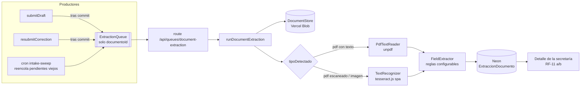

# Investigación: extracción de datos por OCR (`document-extraction`)

> Fecha: 2026-10-17 · Estado: investigación previa, sin change abierto.
> Change del roadmap: #4 `document-extraction` (RF-11, RNF-03) — prioridad
> «si alcanza el tiempo», estado `pendiente`.

## Índice

1. [Qué piden los requisitos](#1-qué-piden-los-requisitos)
2. [Contexto técnico actual del proyecto](#2-contexto-técnico-actual-del-proyecto)
3. [Cómo se construiría](#3-cómo-se-construiría)
4. [¿Proyecto aparte o integrado?](#4-proyecto-aparte-o-integrado)
5. [Comparativa de motores de OCR](#5-comparativa-de-motores-de-ocr)
6. [¿Síncrono o con cola / máquina de estados?](#6-síncrono-o-con-cola--máquina-de-estados)
7. [Alternativas de cola](#7-alternativas-de-cola)
8. [El cron existente (`intake-sweep`)](#8-el-cron-existente-intake-sweep)
9. [Extracción dinámica](#9-extracción-dinámica)
10. [Arquitectura propuesta](#10-arquitectura-propuesta)
11. [Plan de implementación](#11-plan-de-implementación)
12. [Recomendación](#12-recomendación)
13. [Riesgos y preguntas abiertas](#13-riesgos-y-preguntas-abiertas)
14. [Fuentes](#14-fuentes)

---

## 1. Qué piden los requisitos

Fuente: `docs/requirements.md`.

| ID | Contenido |
|---|---|
| **RF-11** (Media) | Cuando se envíe una solicitud, el sistema deberá extraer los datos de sus documentos de respaldo mediante OCR. (a) El detalle muestra el nombre del estudiante, el emisor, la fecha de emisión y el período de reposo extraídos. (b) Un dato no reconocido aparece como «no reconocido», sin valor. |
| **RNF-03** (Alta) | El OCR se ejecuta en el propio entorno de ejecución del sistema. Criterio: en 10 extracciones, ninguna petición saliente hacia un servicio externo contiene el documento ni su texto. |
| **RF-14** (Alta) | La secretaría registra o corrige los datos del documento; se marcan como «ingresado manualmente». (c) Sin datos extraídos por OCR, la solicitud se resuelve con los datos registrados. |
| **RN-24** | Un dato ingresado o corregido por la secretaría prevalece sobre el extraído por OCR. |
| **RN-11 / RN-12** | La firma y el sello los marca la secretaría, no el OCR. |
| **RF-05 (d)** | El veredicto sugerido no cambia el estado de la solicitud. |
| **FA-04** | Descartado (2026-10-12): enviar el documento a un OCR externo como contingencia. Contradecía RNF-03 y exigía un segundo consentimiento. Lo que el OCR local no reconoce lo completa la secretaría. |
| **Changelog 2026-10-12** | RF-11 se dispara al enviar la solicitud; la extracción y el veredicto son **asíncronos**. |

**Conclusión:** el OCR es una ayuda a la secretaría, no una pieza crítica del
flujo. Si falla, la solicitud se resuelve igual con datos manuales.

Documento relacionado no presente en el repositorio:
`bitacora/veredicto_ocr_anonimizacion_2026-10-12.md` (citado en el changelog
de requisitos). Puede contener un veredicto previo sobre el motor.

---

## 2. Contexto técnico actual del proyecto

| Aspecto | Estado actual |
|---|---|
| Framework | Next.js 16 (monolito, sin backend separado — decisión documentada en `docs/otros/Capitulo-IV/Cap-IV-Implement.md`) |
| Despliegue | Vercel, región `cle1` (`vercel.json`) |
| Base de datos | Neon (Postgres) con Drizzle |
| Almacenamiento de documentos | Vercel Blob privado (`@vercel/blob`) |
| Formatos admitidos | PDF, PNG, JPEG; máximo 10 MB; validación por firma binaria (spec `supporting-documents`) |
| Tabla de documentos | `DocumentoRespaldo` con `Estado` (`pendiente`, `valido`), `TipoDetectado`, `RetiradoEn` (`src/db/schema.ts`) |
| Puertos existentes | `DocumentStore` con `stream()` para leer el archivo (`src/lib/intake/ports.ts`); composition root en `src/lib/intake/deps.ts` |
| Cron existente | `/api/cron/intake-sweep`, diario (`0 9 * * *`) — ver sección 8 |

Límites de Vercel Functions con Fluid compute (plan Hobby): **300 s** de
duración por defecto y máxima, **2 GB** de memoria, 1 vCPU. En Pro: hasta
800 s y 4 GB.

---

## 3. Cómo se construiría

### Pipeline por documento

1. **Lectura** del archivo desde Vercel Blob privado.
2. **Obtención del texto**, según el tipo:
   - **PDF digital**: extraer la capa de texto con `unpdf` (`extractText`). Sin OCR; instantáneo y exacto.
   - **PDF escaneado** (sin capa de texto): renderizar cada página a imagen con `unpdf` (`renderPageAsImage`) + `@napi-rs/canvas`, y pasarla al OCR.
   - **Imagen (PNG/JPEG)**: OCR directo. Preprocesado opcional con `sharp` (escala de grises, rotación, contraste).
3. **OCR** con `tesseract.js` y el modelo de idioma `spa`.
   - Funciona en WASM, sin binarios nativos.
   - El archivo `.traineddata` se incluye en el repositorio (vía `langPath` local y `outputFileTracingIncludes`). Por defecto tesseract.js lo descarga de un CDN; esa descarga no contiene el documento, pero incluirlo localmente simplifica la verificación de RNF-03.
4. **Interpretación del texto** (parsing con heurísticas en español):
   - Fechas: patrones `dd/mm/aaaa`, `dd de <mes> de aaaa`.
   - Período de reposo: «reposo por N días», «del … al …», «hasta el …».
   - Emisor: encabezado del documento (primeras líneas, nombres de clínica, hospital o centro de salud).
   - Nombre del estudiante: ya se conoce por la cuenta; conviene **comparar** con coincidencia aproximada en lugar de extraer libremente.
   - Lo que no se reconoce queda en `null` y se muestra como «no reconocido».

### Paquetes candidatos

| Paquete | Uso |
|---|---|
| `tesseract.js` | Motor OCR (WASM) |
| `@tesseract.js-data/spa` o `tessdata` (`4.0.0_best_int`) | Modelo de idioma español |
| `unpdf` | Extracción de texto y renderizado de PDF (incluye build serverless de PDF.js) |
| `@napi-rs/canvas` | Canvas nativo requerido por `unpdf` para renderizar en Node.js — **verificar en un despliegue de prueba en Vercel** |
| `sharp` | Preprocesado de imágenes (soportado en Vercel) |

---

## 4. ¿Proyecto aparte o integrado?

### Recomendado: integrado en el monolito Next.js

- Coherente con la decisión de arquitectura ya documentada (monolito sin backend separado).
- RNF-03 se cumple de forma natural: el OCR corre en las mismas funciones de Vercel que ya almacenan el documento en Blob; no se suma un tercero.
- Los límites de Hobby (300 s, 2 GB) alcanzan para Tesseract con documentos de 1 a 3 páginas.
- La prioridad del change es baja; un segundo servicio agrega despliegue, autenticación entre servicios y monitoreo.

### Cuándo se justificaría un microservicio aparte

Solo si Tesseract no alcanza la precisión necesaria con documentos reales.
En ese caso: PaddleOCR (Python) o un VLM local (sección 9) en un contenedor
Docker sobre infraestructura propia (VPS, Railway, Fly.io), expuesto como API
interna.

| Criterio | Integrado (Tesseract.js) | Microservicio (PaddleOCR) |
|---|---|---|
| Precisión con texto impreso limpio | Buena | Buena |
| Precisión con fotos torcidas o ruidosas | Regular | Mejor |
| Tamaño de dependencias | ~10 MB | ~500 MB |
| Velocidad (referencia) | ~0,8 s | ~4,9 s |
| Infraestructura extra | Ninguna | Contenedor, deploy, autenticación |
| RNF-03 | Cumple | Cumple solo si la infraestructura es propia |

---

## 5. Comparativa de motores de OCR

| Motor | Lenguaje | Puntos fuertes | Puntos débiles |
|---|---|---|---|
| **Tesseract 5 / tesseract.js** | C++ / WASM | Liviano, rápido, sin GPU, buen soporte de español | Requiere ~300 DPI; sensible a inclinación y ruido; débil con manuscrito |
| **PaddleOCR** | Python | Mejor en imágenes degradadas, sin preprocesado | Pesado, integración más compleja, GPU recomendable |
| **docTR** | Python | Buen rendimiento general | Evidencia de benchmarks más débil; pesado |
| **EasyOCR** | Python | Fácil de usar | Similar a PaddleOCR en peso, menor precisión |

Benchmarks encontrados: en texto impreso limpio, incluido un caso en español,
los tres motores principales rinden parecido (0,993 a 1,000). En un test de
facturas en inglés (marzo 2026): PaddleOCR 100 %, Tesseract 5.5 87,5 %, docTR
~91,7 %. **No hay benchmarks específicos de constancias médicas en español**;
hay que medir con documentos propios.

### Manuscrito

Tesseract fue diseñado para texto impreso. Los estudios disponibles (antiguos,
Tesseract 2.01) reportan ~83,5 % de precisión por carácter y ~45,8 % por
palabra en manuscrito. Muchas constancias médicas son manuscritas: es el
riesgo principal y la razón de existir de RF-14.

---

## 6. ¿Síncrono o con cola / máquina de estados?

### Síncrono dentro del envío: no recomendado

- Cada página tarda varios segundos en 1 vCPU; una solicitud admite hasta 5 documentos con varias páginas.
- El estudiante queda esperando la respuesta.
- Un fallo o timeout del OCR rompería el envío por algo no obligatorio.
- Contradice la decisión del 2026-10-12 (extracción asíncrona).

### `after()` de Next.js como única pieza: no recomendado

Ejecuta trabajo después de responder, pero no es durable: si falla o excede
el tiempo, se pierde sin reintento.

### Recomendado: máquina de estados por documento + cola

El detalle de la máquina de estados y del modelo de datos está en la
sección 10. Reglas de diseño:

- El mensaje lleva **solo identificadores**, nunca el contenido del documento ni el texto extraído (RNF-03; además, la cola factura por bloques de 4 KiB).
- Los datos extraídos viven en Neon, sujetos a la cancelación a los 5 años (RNF-04).
- El consumidor debe ser idempotente: la entrega es *at-least-once*.

---

## 7. Alternativas de cola

| Opción | A favor | En contra |
|---|---|---|
| **Vercel Queues** (recomendada) | Durable, reintentos automáticos, disponible en todos los planes; Hobby incluye 1.000.000 de operaciones; visibility timeout hasta 60 min; retención hasta 7 días | En **beta pública**; configuración de consumidor vía `experimentalTriggers` en `vercel.json` |
| **Vercel Workflows** | Pasos durables, observabilidad integrada, reanudación tras fallos | Excesivo para un solo paso; registra inputs/outputs de cada paso en la persistencia gestionada por Vercel — si el texto del OCR pasa como output, queda almacenado fuera de Neon |
| **Neon como cola** (`SELECT … FOR UPDATE SKIP LOCKED`) + `after()` + cron | Sin dependencias beta; todo en infraestructura ya usada | En Hobby el cron es diario: un fallo se reintenta recién al día siguiente |
| **Servicios externos** (Inngest, QStash) | Maduros | Suman un tercero; revisar contra RNF-03 aunque solo reciban IDs |

Variante conservadora: `after()` para disparar la extracción + barrido en el
cron diario existente (`intake-sweep`) que reprocesa documentos `pendiente` o
`fallida`. Funciona porque el OCR no es crítico; la contrapartida es la
latencia ante fallos.

### Límites de Vercel Queues (referencia)

| Recurso | Mín. | Máx. | Por defecto |
|---|---|---|---|
| Retención (TTL) | 60 s | 7 días | 24 h |
| Visibility timeout | 0 s | 60 min | 60 s |
| Tamaño de mensaje | — | 100 MB | — |
| Reintentos | — | 32 con delay configurado, luego backoff forzado | — |

---

## 8. El cron existente (`intake-sweep`)

Limpieza diaria del flujo de solicitudes. Vercel lo ejecuta a las 9:00 UTC
(`0 9 * * *` en `vercel.json`) llamando a `/api/cron/intake-sweep`, protegido
por la credencial del planificador (`CRON_SECRET`). La lógica está en
`runIntakeSweep` (`src/lib/data/intake-sweep.ts`) y tiene tres pasos
independientes:

| Paso | Función | Qué borra |
|---|---|---|
| 1 | `sweepDrafts` | Solicitudes en `borrador` sin actividad durante más de `DRAFT_TTL_DAYS`, con sus archivos en Blob |
| 2 | `sweepPendingDocuments` | Documentos en `pendiente` (finalización fallida) de un borrador, pasadas `PENDING_GRACE_HOURS` |
| 3 | `sweepOrphans` | Archivos de Blob bajo el prefijo de intake sin fila en `DocumentoRespaldo`, pasadas `ORPHAN_GRACE_HOURS` |

Características: solo toca borradores; es idempotente y continúa ante fallos
(los cuenta en `failures`); borra primero filas y después archivos; no escribe
auditoría porque no hay actor humano (D14); procesa en lotes de 100 con un
tope de 50 lotes.

**Relación con el OCR:** hoy no hace nada de extracción. Se propone un cuarto
paso que reencole los documentos con extracción `pendiente` antigua o
`fallida` reintentable, como red de seguridad del encolado post-commit
(sección 10). Su límite: corre una vez al día.

---

## 9. Extracción dinámica

«Dinámica» puede significar cuatro niveles distintos, con costos muy
diferentes. Evaluación bajo las restricciones del proyecto (RNF-03 local,
Vercel sin GPU y con 2 GB, equipo chico, prioridad baja):

| Nivel | Qué es | Costo | Veredicto |
|---|---|---|---|
| **1. Reglas configurables** | Palabras clave («reposo», «incapacidad», «días»), formatos de fecha y un **catálogo de emisores** conocidos guardados en la base y editables sin tocar código | Bajo | ✅ Viable ya |
| **2. Plantillas por emisor** | Para emisores recurrentes se definen anclas o zonas («la fecha está a la derecha de "Fecha:"») | Medio: requiere una UI para definir plantillas | ⚠️ Solo si los formatos se repiten mucho |
| **3. Modelos KIE entrenados** (LayoutLMv3, Donut, LiLT) | Un modelo aprende a ubicar los campos según el layout | Alto: cientos de documentos etiquetados, Python, entrenamiento. LayoutLMv3 tiene licencia **no comercial** (CC BY-NC-SA 4.0); LiLT es MIT | ❌ Excesivo para el proyecto |
| **4. VLM / LLM local zero-shot** (NuExtract 2.0 2B, Granite Vision 4.1 4B, MiniCPM-V) | Se le pasa la imagen y un esquema JSON con los campos; devuelve los valores sin entrenamiento | Medio-alto: servidor propio con GPU o mucha RAM; no entra en Vercel | ⚠️ Viable como fase 2 |

### Análisis del nivel 4

- **Es el único que puede atacar el manuscrito**, el riesgo principal, y tolera formatos no vistos.
- **Riesgo de alucinación**: puede inventar una fecha verosímil. Mitigaciones:
  - Modo *verbatim* (NuExtract 2.0 tiene el tipo `verbatim-string`, que solo devuelve texto presente en el documento) o validar que el valor aparezca en el texto del OCR.
  - El resultado nunca decide: RF-05 (d) ya establece que el veredicto no cambia el estado.
  - RN-24: el dato de la secretaría prevalece.
- **Latencia**: no es problema gracias a la cola; aunque tarde decenas de segundos por página en CPU, nadie la espera. El tiempo real hay que medirlo.
- **Costo real**: la infraestructura (servicio aparte, deploy, autenticación). Cumple RNF-03 solo si el servidor es propio.

### Recomendación para la extracción dinámica

1. **Ahora**: nivel 1 — Tesseract + reglas configurables + catálogo de emisores (que además sirve a la señal de reincidencia, RN-14).
2. **Puerto intercambiable**: `FieldExtractor` (documento → campos). El nivel 4 entra después como otro adaptador, sin tocar el dominio ni la máquina de estados.
3. **Incluir el VLM en el spike** (fase 1 del plan): probar NuExtract 2.0 2B en una máquina local con los mismos documentos y decidir con datos si se justifica el servidor extra.

---

## 10. Arquitectura propuesta

### Vista general



### Estructura de carpetas (slice hexagonal, mismo patrón que `src/lib/intake/`)

```
src/lib/extraction/
  ports.ts            TextRecognizer, PdfTextReader, FieldExtractor, ExtractionQueue
  fields.ts           extracción por reglas: fechas, reposo, emisor, coincidencia de nombre (dominio puro)
  run.ts              runDocumentExtraction(documentoId, deps): caso de uso
  deps.ts             getExtractionDeps(): composition root
  fakes.ts            dobles de prueba
  adapters/
    tesseract-recognizer.ts
    unpdf-reader.ts
    rules-field-extractor.ts
    vercel-queue.ts
src/lib/data/extraction.ts                      lecturas y escrituras en Neon
src/app/api/queues/document-extraction/route.ts consumidor
```

Reutiliza `DocumentStore.stream()` (`src/lib/intake/ports.ts`) para leer el
archivo.

### Modelo de datos: tabla `ExtraccionDocumento` (1:1 con el documento)

Se propone una tabla aparte en lugar de columnas en `DocumentoRespaldo`: su
`Estado` ya significa «validación de la subida» (`pendiente`, `valido`) y
mezclar un segundo ciclo de vida sería confuso.

| Columna | Descripción |
|---|---|
| `DocumentoId` | PK y FK a `DocumentoRespaldo`, borrado en cascada |
| `Estado` | `pendiente`, `procesando`, `completada`, `fallida`, `no_aplica` |
| `Intentos`, `ErrorCodigo` | Reintentos y diagnóstico |
| `Emisor`, `FechaEmision`, `ReposoDesde`, `ReposoHasta` | Nullables: `null` se muestra como «no reconocido» |
| `NombreCoincide` | Resultado de comparar el nombre leído con el de la cuenta |
| `Motor`, `Confianza`, `ProcesadoEn` | Trazabilidad |

Fuera del modelo, a propósito: el **texto crudo** (son datos de salud;
minimización por RNF-04). Los datos manuales de RF-14 / RN-24 los agrega
`validation-signals` en columnas propias, sin pisar estas.

### Máquina de estados

```
pendiente ──claim (UPDATE … WHERE Estado='pendiente')──► procesando
procesando ──ok──► completada
procesando ──error, intentos < 3──► pendiente     (la cola reintenta)
procesando ──error, intentos = 3──► fallida      (la secretaría carga a mano)
cualquiera ──documento retirado──► no_aplica
```

El *claim* condicional hace idempotente al consumidor, porque la cola entrega
*at-least-once*.

### Encolado post-commit (outbox implícito)

El mensaje se publica **después** del commit de `submitDraft` /
`resubmitCorrection`. Si la publicación falla, la fila queda en `pendiente` y
el cuarto paso del cron la reencola. La propia tabla actúa como *outbox*: no
se pierde trabajo y no hace falta infraestructura extra.

---

## 11. Plan de implementación

El proyecto tiene Strict TDD activo: cada fase empieza por los tests.

| # | Fase | Entregable | Gate |
|---|---|---|---|
| 0 | **Prerrequisitos** | Archivar el change activo (`backoffice-ui-refresh`), asignar responsable, ubicar el veredicto de la bitácora | — |
| 1 | **Spike** (1–2 días, rama descartable) | tesseract.js + unpdf en un preview de Vercel con ~20 documentos reales anonimizados; en paralelo, NuExtract 2.0 2B en una máquina local. Medir precisión por campo, tiempo por página y tamaño del bundle | **Go/no-go** del motor |
| 2 | **Abrir el change** | `/sdd-new document-extraction` con `docs/sdd-new-template.md`; specs citando RF-11 y RNF-03 | Proposal aprobada |
| 3 | **Dominio** | Extracción por reglas + tests con los textos del spike como fixtures | Tests verdes |
| 4 | **Datos** | Schema y migración de `ExtraccionDocumento` | Confirmación explícita antes de `db:migrate` |
| 5 | **Caso de uso** | `runDocumentExtraction` + puertos + fakes (claim, reintentos, `fallida`) | Tests con fakes |
| 6 | **Adaptadores** | Tesseract (`.traineddata` local), unpdf, reglas, cola | Tests de integración |
| 7 | **Productores** | Encolar en `submitDraft` y `resubmitCorrection` (ya tiene el comentario del hook para RF-11) + cuarto paso en `runIntakeSweep` | Tests existentes intactos |
| 8 | **Consumidor** | Route con `handleCallback`, `experimentalTriggers` y `maxDuration` en `vercel.json` | Prueba en preview |
| 9 | **UI** | Sección «Datos extraídos» por documento en el detalle de la secretaría, con estado («extrayendo…», datos, «no reconocido») | RF-11 (a) y (b) |
| 10 | **RNF-03** | Test que bloquea toda red saliente durante 10 extracciones | Criterio de aceptación literal |
| 11 | **Cierre** | `sdd-verify` + `sdd-archive`; actualizar el estado en `docs/roadmap.md` | — |

### Decisiones a cerrar en la fase 2

- **Cola**: Vercel Queues (beta) o `after()` + cron diario.
- **Auditoría**: si la extracción escribe eventos en la bitácora (el precedente D14 dice que no hay auditoría sin actor humano).
- **Reproceso en correcciones**: re-extraer solo los documentos nuevos o todos.
- **Motor**: Tesseract solo, o Tesseract + adaptador VLM según el spike.

---

## 12. Recomendación

1. **Spike de precisión primero**, incluyendo un VLM local como comparación.
2. Si el resultado es aceptable: **OCR integrado en el monolito**, con puertos y adaptadores.
3. **Extracción por reglas configurables** (nivel 1) detrás de un puerto `FieldExtractor` intercambiable.
4. **Asíncrono**: máquina de estados en `ExtraccionDocumento` + Vercel Queues con solo IDs + cron como red de seguridad.
5. Microservicio (PaddleOCR o VLM) solo si el spike demuestra que Tesseract no alcanza.

---

## 13. Riesgos y preguntas abiertas

- **Manuscrito**: Tesseract probablemente no lo reconozca; RF-14 cubre ese caso, y un VLM podría mejorarlo.
- **Alucinación de un VLM**: mitigable con modo verbatim y validación contra el texto del OCR.
- **`@napi-rs/canvas` en Vercel**: dependencia nativa; validar empaquetado y tamaño en un despliegue de prueba.
- **Vercel Queues en beta**: posible cambio de API (`queue/v2beta`).
- **Interpretación de RNF-03**: confirmar que «propio entorno de ejecución» incluye la infraestructura de Vercel donde ya corre la aplicación (Blob, Functions).
- **Plan Hobby**: es para uso no comercial; revisar si aplica al proyecto en producción.
- **Orden del roadmap**: antes del #4 siguen pendientes el #0 (`catalog-schedule`) y el #3 (`teacher-remission`); el #4 no tiene responsable asignado.
- **Veredicto previo**: localizar y leer `bitacora/veredicto_ocr_anonimizacion_2026-10-12.md`.

---

## 14. Fuentes

Vercel:

- [Vercel Functions: limitations](https://vercel.com/docs/functions/limitations)
- [Higher defaults and limits for Vercel Functions running Fluid compute](https://vercel.com/changelog/higher-defaults-and-limits-for-vercel-functions-running-fluid-compute)
- [Vercel Queues](https://vercel.com/docs/queues)
- [Vercel Queues: pricing and limits](https://vercel.com/docs/queues/pricing)
- [Vercel Queues now in public beta](https://vercel.com/changelog/vercel-queues-now-in-public-beta)
- [Vercel Workflows](https://vercel.com/docs/workflow)
- [Workflow SDK](https://workflow-sdk.dev)

OCR y PDF:

- [tesseract.js: local installation](https://unpkg.com/tesseract.js@6.0.1/docs/local-installation.md)
- [naptha/tessdata](https://github.com/naptha/tessdata)
- [unpdf (README)](https://cdn.jsdelivr.net/npm/unpdf@1.6.2/README.md)
- [unpdf en Socket](https://socket.dev/npm/package/unpdf/overview/1.5.0)

Comparativas de OCR:

- [Codesota: PaddleOCR vs Tesseract](https://codesota.com/ocr/paddleocr-vs-tesseract)
- [LlamaIndex: best OCR libraries for developers](https://llamaindex.ai/blog/best-ocr-libraries-for-developers)
- [DEV Community: best Python OCR libraries](https://dev.to/felipe_anyformat/best-python-ocr-libraries-179)
- [Iron Software: PaddleOCR vs Tesseract](https://ironsoftware.com/ocr/csharp/blog/compare-to-other-components/paddle-ocr-vs-tesseract/)
- [Mejores modelos open source de OCR 2026 (javadex)](https://www.javadex.es/blog/mejores-modelos-open-source-ocr-reconocimiento-texto-2026)

Manuscrito:

- [Recognition of Handwritten Roman Script Using Tesseract (arXiv 1003.5891)](https://arxiv.org/pdf/1003.5891)
- [Multi-user handwriting recognition with Tesseract (arXiv 1003.5886)](https://arxiv.org/pdf/1003.5886)

Extracción dinámica (KIE y VLM):

- [NuExtract 2.0 (NuMind)](https://numind.ai/blog/outclassing-frontier-llms-nuextract-2-0)
- [NuExtract-2.0-8B en Hugging Face](https://huggingface.co/numind/NuExtract-2.0-8B-GPTQ/blob/main/README.md)
- [Granite Vision 4.1 4B (IBM)](https://replicate.com/ibm-granite/granite-vision-4.1-4b)
- [Guía de visión multimodal local con Ollama](https://bestllmfor.com/guide/llm-multimodal-vision-local-ollama/)
- [Visión en modelos locales chicos (MindStudio)](https://www.mindstudio.ai/blog/add-vision-to-local-ai-agent-small-model)
- [Practical approaches to key information extraction (DEV)](https://dev.to/mrzaizai2k/practical-approaches-to-key-information-extraction-part-2-a6o)
- [Licencia de LayoutLMv3 (unilm #707)](https://github.com/microsoft/unilm/issues/707)
- [Licencia de LayoutLMv3 (unilm #1103)](https://github.com/microsoft/unilm/issues/1103)
- [LiLT con licencia MIT (Towards Data Science)](https://towardsdatascience.com/how-to-train-the-lilt-model-on-invoices-and-run-inference-8fd6b3cfae1b)

Documentos internos:

- `docs/requirements.md` — RF-05, RF-11, RF-14, RN-24, RNF-03, FA-04, changelog.
- `docs/roadmap.md` — change #4 `document-extraction`.
- `openspec/specs/supporting-documents/spec.md` — formatos y tamaño.
- `src/db/schema.ts` — tabla `DocumentoRespaldo`.
- `src/lib/intake/ports.ts`, `src/lib/intake/deps.ts` — puertos y composition root existentes.
- `src/lib/data/intake-sweep.ts` — cron de limpieza.
- `src/lib/data/solicitudes.ts`, `src/lib/data/solicitud-correction.ts` — envío y reenvío.
- `docs/otros/Capitulo-IV/Cap-IV-Implement.md` — decisión de monolito.
