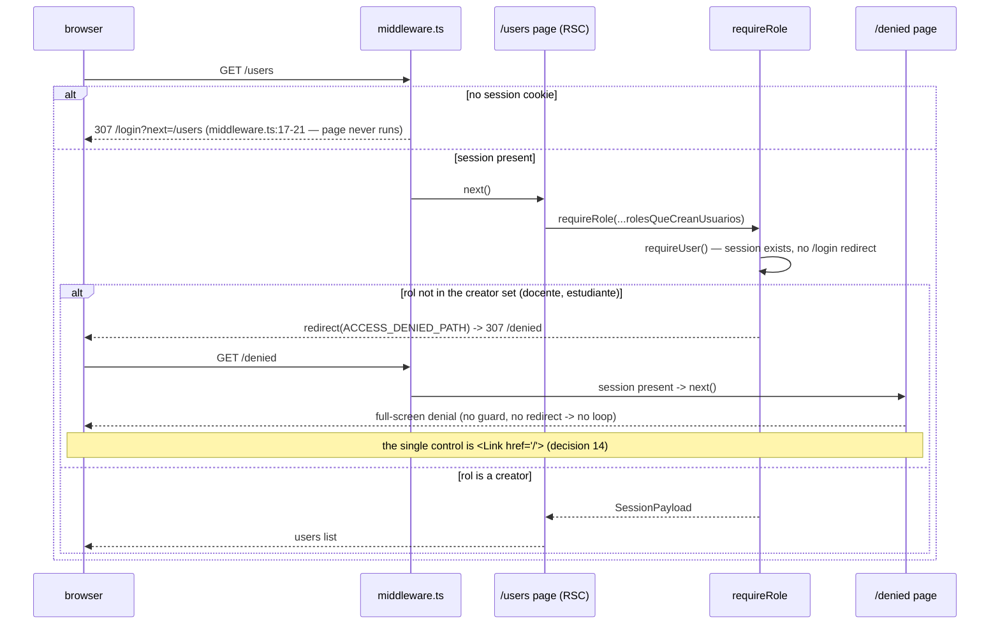
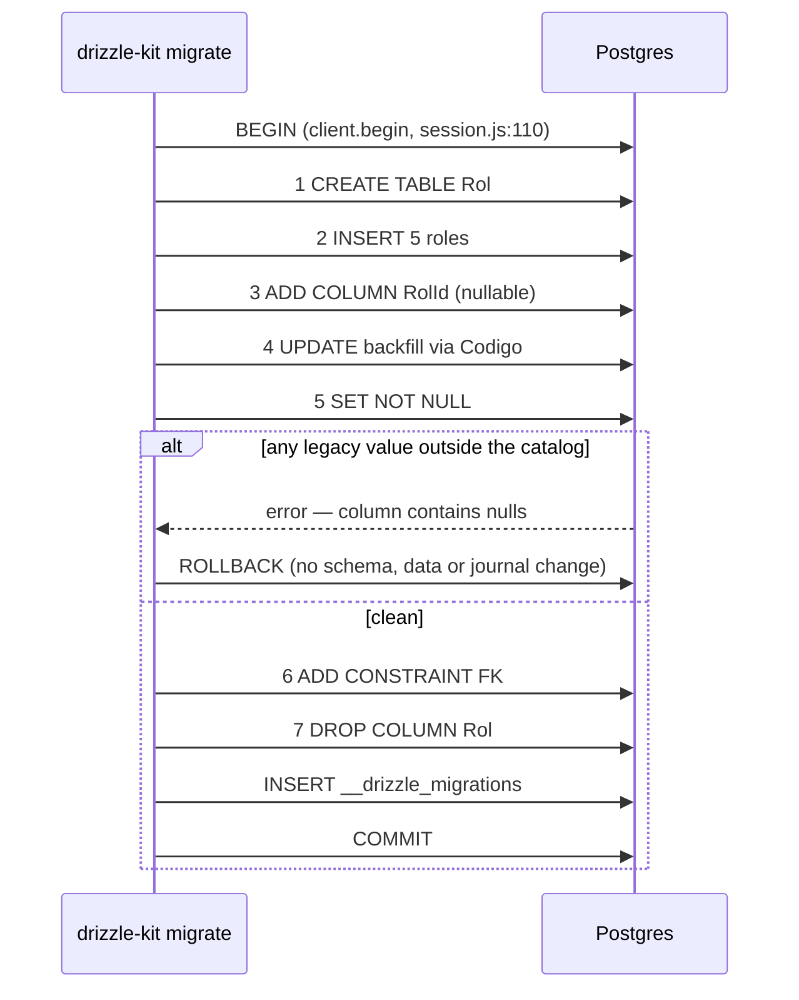

# Design: Roles Lookup Table, Role-Assignment Hierarchy, Permission-Denied Screen and Viewer-Scoped Users List

> DB-touching change. Nothing here may be applied to Neon without per-command
> user confirmation. This document plans commands; it runs none.

## Verified finding: the migrator IS transactional

The proposal marked this unconfirmed. Confirmed by reading the installed code:

| Evidence | File:line | Fact |
|---|---|---|
| Driver selection | `node_modules/drizzle-kit/bin.cjs:78945-78963` | `pg` is absent (`node_modules/pg` does not exist), so `drizzle-kit migrate` loads `drizzle-orm/postgres-js/migrator` |
| Migration loop | `node_modules/drizzle-orm/pg-core/dialect.js:60-71` | `await session.transaction(async (tx) => { ... })` wraps **every pending migration**, each statement, and the `__drizzle_migrations` insert |
| Real transaction | `node_modules/drizzle-orm/postgres-js/session.js:108-110` | `transaction()` → `client.begin(...)` (real `BEGIN`/`COMMIT`) |
| File splitting | `node_modules/drizzle-orm/migrator.js:16` | The `.sql` file is split on `--> statement-breakpoint`; each chunk is one `client.unsafe()` call (`session.js:33`, `:65`) |

Consequences, all stronger than the proposal assumed:

- **Do NOT hand-write `BEGIN`/`COMMIT`.** It would nest inside the driver
  transaction and break it. Postgres DDL is transactional, so an abort leaves
  zero schema/data change and no journal row.
- Pending migrations share **one** transaction, not one per file. If `0000`/`0001`
  are unapplied on Neon, they would run together with `0002`.
- `CREATE SCHEMA drizzle` and the migrations-table create run **outside** the
  transaction (`dialect.js:54-55`); harmless and idempotent.
- Rollback plan step 3 in the proposal is confirmed, not assumed.
- Do **not** install `pg`: the postgres-js migrator already gives the
  transactional behaviour this plan depends on.

## Second verified finding (corrects the exploration)

`src/lib/auth/permissions.ts:8` is `["secretaria", "administrador"]` — `docente`
is **not** a user manager. The escalation is real but narrower: a `secretaria`
can create an `administrador`. Also, `src/lib/auth/permissions.test.ts:25-29`
asserts the constant equals every role except `estudiante`, which the constant
does **not** satisfy — `npm test` is red in the working tree today. Work unit 1
must reconcile that assertion, otherwise strict TDD cannot distinguish a new RED
from the pre-existing one.

## Third verified finding (enables the two-layer check)

`requireRole` (`src/lib/auth/dal.ts:19-25`) **returns the `SessionPayload`**,
which carries `rol: RolUsuario` (`session.ts:8-13`). Layer (a) therefore hands
the caller's role to layer (b) for free: no second session read, no DB lookup,
and no window in which the two layers could disagree about who the caller is.
Both `createStaffAction` and `new/page.tsx` must stop discarding that return
value. The users **list** page needs the same return value for a third reason:
it is the only trustworthy source of the viewer scope (finding 8).

## Fourth verified finding: the complete guard-caller inventory

Re-verified in the working tree for this revision, because changing `requireRole`
changes denial for every caller at once.

| Guard | Call sites (exhaustive) | Today's denial |
|---|---|---|
| `requireRole` | `users/page.tsx:33`, `users/new/page.tsx:19`, `users/new/actions.ts:19` | `redirect("/")` (`dal.ts:23`) |
| `requireUser` | `(dashboard)/layout.tsx:13`, `profile/page.tsx:30`, and internally `dal.ts:22` | `redirect("/login")` (`dal.ts:15`) |
| `getCurrentUser` | `(auth)/login/page.tsx:11`, `(auth)/register/page.tsx:8` | none — returns `null` |

Three `requireRole` call sites, all inside the users module, all named in this
design and all getting a test. `requireUser` is untouched: the anonymous branch
keeps going to `/login`.

## Fifth verified finding: the unauthenticated branch never reaches the screen

`middleware.ts:17-21` redirects **every** matched path without a session to
`/login?next=<path>`, and the matcher (`:28`) covers everything except `api`,
`_next/static`, `_next/image`, `favicon.ico` and any path with a file extension.
`/login` and `/register` are handled earlier (`:10-15`) and are therefore not
part of that branch. So an anonymous request for the denied screen is turned
into `/login` by the middleware before any page code runs, and `/login` cannot
bounce back. That is the structural half of the no-loop guarantee; decision 15
supplies the other half.

## Sixth verified finding: measured contrast on the destructive red

Computed from the installed token values (`globals.css:138`, `:185`) by the
OKLCH → OKLab → linear-sRGB → WCAG relative-luminance chain, clamping
out-of-gamut channels as a browser would. These numbers are hand-computed in
this phase (the design sub-agent has no shell); decision 16 makes them a
**runnable test**, which is the real gate.

| Text | Surface | Ratio | Floor | Verdict |
|---|---|---|---|---|
| white `oklch(1 0 0)` | light `--destructive` `oklch(0.577 0.222 28.8)` | **4.85:1** | 4.5 | passes, no headroom |
| `--foreground` ink-900 | light `--destructive` | **3.21:1** | 4.5 | fails |
| white | dark `--destructive` `oklch(0.704 0.191 22.2)` | **2.89:1** | 4.5 | fails |
| dark `--foreground` `oklch(0.97 0.005 240)` | dark `--destructive` | **2.65:1** | 4.5 | fails |
| ink-900 | dark `--destructive` | **5.37:1** | 4.5 | passes |
| proposed `--denied-foreground` | proposed `--denied` | **6.27:1** | 4.5 | passes both themes |
| white | proposed `--denied` | **6.50:1** | 4.5 | passes both themes |
| `--ring` teal `oklch(0.729 0.127 211)` | proposed `--denied` | **2.83:1** | 3.0 (UI) | **fails** — see decision 17 |

Relative luminances used: white `1.00000`, `--denied-foreground` `0.96361`,
dark `--foreground` `0.91332`, `--ring` `0.40729`, dark `--destructive`
`0.31306`, light `--destructive` `0.16670`, `--denied` `0.11160`, ink-900
`0.01756`.

**Reading**: the shipped `--destructive` cannot carry a full-bleed denial
surface with a *single* foreground colour. White passes in light and fails in
dark; ink-900 does the opposite. Hence decision 16.

## Seventh verified finding: check (b) never sees an invalid or student role

Added for this revision, because reversing decision 10 only makes sense if the
redirect cannot hit a typo. `crearStaffSchema.rol` is `rolStaffSchema`
(`src/lib/validations/users.ts:47`), and `rolStaffSchema` is
`z.enum(rolesStaff)` (`:13`), where `rolesStaff = rolesUsuario.filter(r => r !== "estudiante")`
(`:9-11`).

So `crearStaffSchema.safeParse` **already rejects** `estudiante`, an empty
`rol`, and any string outside the four staff codes, and `actions.ts:31-33`
returns `{ error: t("errors.invalid") }` for all of them — *before* check (b)
runs. Check (b) therefore fires on exactly one population: a **syntactically
valid staff role that this caller may not assign** (e.g. `secretaria` →
`administrador`). That is the adversarial case, not a malformed form, which is
what makes a redirect to `/denied` proportionate (decision 10).

## Eighth verified finding: Drizzle gives the list query everything it needs

All four checked against the installed `drizzle-orm@0.45.2`, because the users
list depends on each one.

| Question | Evidence | Answer |
|---|---|---|
| Is the ILIKE pattern a bind parameter? | `node_modules/drizzle-orm/sql/expressions/conditions.js:121-123` — `ilike(column, value)` is `` sql`${column} ilike ${value}` `` | Yes. The search term never reaches the SQL text, so escaping is a *wildcard* problem, not an injection one |
| Does escaping need an `ESCAPE` clause? | Postgres' default `LIKE`/`ILIKE` escape character is backslash; the pattern arrives as a parameter, so `standard_conforming_strings` does not apply | No. `\%`, `\_`, `\\` in the bound pattern match literally with the stock `ilike()` helper — no `sql` template needed |
| What does an empty scope emit? | `conditions.js:73-77` — `inArray(col, [])` returns `` sql`false` `` | It **fails closed**: an unknown or empty-scope viewer gets zero rows, never all rows. This is the argument for the branch-free scope in decision 18 |
| Can the SQL be asserted without a database? | `pg-core/query-builders/select.js:730-733` (`toSQL()`) and `pg-core/query-builders/query-builder.js:6-12,83-88` (`QueryBuilder` lazily builds its own `PgDialect`, takes no client) | Yes. `new QueryBuilder().select()...toSQL()` returns `{ sql, params }` with **no connection and no `@/db` import** — which matters because `src/env.ts:11` calls `envSchema.parse(process.env)` at import time and would throw in the test runner |

## Ninth verified finding: `searchParams` is a Promise in this Next

`src/app/(auth)/login/page.tsx:9` types the prop as
`searchParams: Promise<{ next?: string }>` and `:14` awaits it. That is the
repo's own, working usage on Next `16.3.4`, so the users list page follows it
verbatim rather than relying on `node_modules/next/dist/docs/`, which ships only
an index stub (AGENTS.md). No new Next API is introduced by the list.

## Technical Approach

Keep `rolesUsuario` (`src/lib/validations/auth.ts:7`) as the type source of
truth; the DB mirrors it. Contain the surrogate key inside the data layer: reads
project the catalog code back onto a field still named `rol`, and `createUsuario`
resolves code → id internally. Actions, pages, UI, session and `middleware.ts`
then need no change for the schema work.

The access-control half is **two tables of data** in `permissions.ts` — caller →
assignable roles (`rolesAsignables`) and viewer → visible role codes
(`rolesVisibles`) — and everything else is derived from them, so each rule
exists exactly once. Denial for an authenticated caller, whether the whole page
or a single refused role assignment, becomes a redirect to one generic
full-screen `/denied` page that is reachable by anyone with a session and
guarded by no role, which is what makes it loop-free.

The users list is a server-rendered table whose entire state (`page`, `q`) lives
in the URL and is resolved on the server: the viewer scope, the search and the
pagination are all one SQL `where`, and no policy value ever arrives from the
client.

Six work units (WU1b, WU1a, WU3a, WU3b, WU3c, WU2 — see *Work Units and Order*).
Only WU3b→WU3c and WU3a→WU3c are ordered by dependency; WU2 is independent of
all of them and lands last on purpose.

Specs: `specs/user-roles/spec.md`, `specs/staff-account-creation/spec.md`,
`specs/permission-denied-screen/spec.md`, `specs/users-listing/spec.md`.

## Architecture Decisions

| # | Decision | Alternatives rejected | Rationale |
|---|---|---|---|
| 1 | Hand-order the 7 steps in `drizzle/0002_*.sql`; keep the generated `meta/0002_snapshot.json` and `_journal.json` untouched | Let `drizzle-kit generate` emit it as-is | Generated output would `ADD COLUMN ... NOT NULL` + `DROP COLUMN` on a populated table and fail. The snapshot describes the **end state**, which the hand-ordered SQL also reaches; the `__drizzle_migrations` hash is computed over the `.sql` at apply time, so editing before applying is safe |
| 2 | Abort-on-unknown-role is `ALTER COLUMN "RolId" SET NOT NULL` | A `DO $$ ... RAISE EXCEPTION $$` guard naming offending values | `SET NOT NULL` cannot be bypassed and is already required; a guard block adds hand-written PL/pgSQL to review and could be deleted. The operator-facing diagnosis is the read-only pre-check below |
| 3 | Read DTO keeps the field name `rol` carrying the **code**, via `innerJoin` | Expose `rolId` and resolve in each consumer; `leftJoin` | Zero changes in `users/page.tsx`, `profile/page.tsx`, `login/actions.ts`. `innerJoin` is total because the FK is NOT NULL |
| 4 | `createUsuario` accepts `rol: RolUsuario` and resolves the id internally | Resolve in each action; inline `(select "Id" from "Rol" ...)` subquery | Both call sites (`register/actions.ts:51`, `users/new/actions.ts:53`) stay unchanged; one place owns the mapping; a subquery would turn an unknown code into an opaque NOT NULL violation |
| 5 | `$type<RolUsuario>()` on `rol.codigo`; `src/db` imports `src/lib/validations` | Cast at every read; DB as type authority | Removes the `as RolUsuario` cast at `login/actions.ts:47`. No cycle: `validations/auth.ts` imports only `zod` |
| 6 | Standalone idempotent `seed-roles.ts` + `db:seed` chains roles before users | Inline the roles into `seed.ts` | Mirrors `seed-carreras.ts`; the pure data module stays unit-testable. The migration still inserts the roles because it must satisfy the FK on **existing** databases, where a seed runs too late |
| 7 | Narrow the catch-all: rethrow `RolDesconocidoError`, keep `errors.duplicate` for the rest | Leave `users/new/actions.ts:60` as is; redesign all error messages | Two lines; stops a config error from masquerading as "duplicate login". Message redesign is out of scope |
| 8 | The hierarchy is **one total `Record<RolUsuario, readonly RolUsuario[]>`** (`rolesAsignables`) in `permissions.ts`; every predicate and every list is derived from it | A `canAssignRole` function with a `switch`/`if` chain; a `Set` of allowed `"caller:target"` strings; a numeric rank per role with "may assign rank-1" | `satisfies Record<RolUsuario, ...>` makes a new role in `rolesUsuario` a **compile error** until its row exists — a switch default, a string Set and a rank arithmetic all fail open or silently. The record is also directly enumerable, which is what the selector and the 5 × 5 test need. A rank would additionally encode a transitivity ("admin outranks docente") the rule explicitly does not grant |
| 9 | Two enforcement layers in `createStaffAction`, in this order: **(a)** `const session = await requireRole(...rolesQueCreanUsuarios)` **before** `safeParse`; **(b)** `canAssignRole(session.rol, parsed.data.rol)` **after** `safeParse` and before the carrera checks, the password hash and any write | One combined check after parsing; check only (b); check (a) and re-derive the caller in (b) via a second `getCurrentUser()` | (a) must precede parsing so a caller with no creation right never causes work or distinguishable timing; (b) cannot precede parsing because the requested role does not exist yet. Placing (b) before `hashPassword` keeps a rejected request free of bcrypt cost. One combined check would force the page guard and the action to use different code paths; a second session read adds a TOCTOU window for zero gain (finding 3) |
| 10 | **REVERSED this revision (user decision).** Layer (b) denial is `redirect(ACCESS_DENIED_PATH)` — the **same target as layer (a)**. There is no form error and **no `users.new.errors.roleNotAllowed` key** | The previous revision's `return { error: t("errors.roleNotAllowed") }`; `notFound()`; `throw`; silently coercing the role to an allowed one | The honest cost is now **accepted rather than avoided**: the previous rationale was that a legitimate user on a stale form would be told the whole module is closed to them, which is imprecise — the user has weighed that and chosen one denial vocabulary anyway. What it buys: a refused *authorization* always lands on the same screen, so an authorization failure can never be mistaken for a validation failure, there is no second copy string to keep in two locales, and the two layers cannot drift apart. Finding 7 bounds the blast radius: `crearStaffSchema` rejects `estudiante`, an empty field and any unknown string as generic invalid data (`errors.invalid`) **before** (b), so the redirect can only be reached by a syntactically valid staff role the caller may not assign — a hand-crafted request or a genuinely stale form, never a typo. Costs recorded: the typed form content is lost on the navigation, and a stale-form user must re-enter it. `notFound()` hides that the page exists; a throw surfaces as a 500 digest; coercion would create an account nobody asked for |
| 11 | `new/page.tsx` computes `rolesAsignablesPor(session.rol)` on the server and passes it to `NewUserForm` as a `rolesAsignables` prop; the form maps that prop instead of `rolesStaff` | Import `permissions.ts` in the client form and derive from a `rol` prop; render all `rolesStaff` and disable the forbidden ones; fetch the list from an endpoint | The form stays presentational: it renders a list it is given and owns no policy (`permissions.ts` is client-importable, so this is a boundary choice, not a technical limit). Disabled options still ship the forbidden values to the browser and a disabled attribute is a hint, not a guard. A new endpoint is surface for data the RSC already holds |
| 12 | **The module policy and the creation policy collapse into one derived source.** `rolesQueGestionanUsuarios` and `canManageUsers` are **deleted**; `rolesQueCreanUsuarios` (`rolesUsuario.filter(canCreateUsers)`) and `canCreateUsers` (`rolesAsignablesPor(rol).length > 0`) replace them. Guards, the sidebar and the specs all read the same pair | Keep both names with identical membership (the previous revision's decision 12); keep `canManageUsers` as an alias so the sidebar never changes; hand-list the creator roles | The user reserved the users module for exactly the creator roles, so two constants would be two spellings of one fact — and the branch that would justify them (`canManageUsers && !canCreateUsers`) is unreachable, i.e. the dead code the previous revision was trying to avoid, now actually created rather than avoided. Deriving both from `rolesAsignables` means a new role cannot gain the sidebar item without gaining creation rights, which is now the intended rule. The concern the old decision protected — a future read-only role silently inheriting the "new user" button — moves to the membership test: adding such a role forces the hand-written literal in `permissions.test.ts` to change, so the author must decide explicitly. Renaming rather than aliasing costs 3 lines in `app-sidebar.tsx` and keeps the vocabulary honest: nothing in the app "manages" users beyond creating them |
| 13 | **`requireRole` redirects an authenticated non-member to `ACCESS_DENIED_PATH`**; the `!user` branch stays inside `requireUser` and keeps `redirect("/login")`. One changed line at `dal.ts:23` | Add an optional `redirectTo` parameter per call site; throw a typed `AccessDeniedError` caught by an `error.tsx` boundary; `notFound()`; keep `redirect("/")` plus a toast | Keeping the split inside `dal.ts` means the authenticated and anonymous denials can never be confused by a caller, and "generic" is guaranteed by construction rather than by three call sites agreeing. A `redirectTo` parameter invites drift across the three sites. An `error.tsx` boundary renders **inside the nearest layout**, so it would reappear inside the dashboard chrome, it keeps the original URL, it is a client component that cannot read the session, and a thrown error inside a server action surfaces as an opaque digest rather than a navigation. `notFound()` hides that the page exists, which is the opposite of the explanation the user asked for. A toast does not survive the navigation without new plumbing and leaves no readable state |
| 14 | **The denied screen is its own top-level segment: `src/app/denied/page.tsx`**, a sibling of the `(auth)` and `(dashboard)` groups, inheriting only the root layout. **Its single control is a link to `/`** (the dashboard root), labelled `denied.back` | `(dashboard)/denied/page.tsx`; a new `(denied)` route group with its own layout; a modal/intercepting route. For the control: `router.back()`; a link to the referring URL; a link to `/login`; two controls (back + logout) | The user asked for a whole-screen red page. `(dashboard)/layout.tsx` wraps children in `SidebarProvider` → `SidebarInset` → `main px-4 py-6` → `.shell` (max-width 1200px), so a full-bleed surface there needs `w-screen`/negative-margin escapes — exactly the templated hack the design system avoids; it would also keep the sidebar and header on screen, which softens a denial into a page-level notice. A `(denied)` group exists to share a layout across several routes; there is one route, so the group is ceremony. The root layout already gives `<body class="flex min-h-full flex-col">` (`layout.tsx:52`) with `<html class="h-full">`, so a single `flex-1` section fills the viewport with no new CSS. **On the destination**: `/` is the one route every authenticated role may open (`(dashboard)/page.tsx` guards with `requireUser`, not `requireRole`), so the way back can never itself be denied. `router.back()` returns to the URL that just denied them — an immediate second redirect and a history loop; the referring URL has the same defect and would additionally need the denied screen to read a parameter, which decision 15 forbids; `/login` is wrong because the caller is authenticated. One control, not two, because the copy names no module and no role and therefore has nothing to offer a second action. Consequence accepted: no sidebar, no header, no theme toggle on this screen — the only control is the way back |
| 15 | **The segment is guarded by nothing.** It calls neither `requireRole` nor `requireUser`, imports nothing from `permissions.ts`, and reads no session or search parameter | `requireUser()` for defence in depth; a role guard listing every role; a `?from=` parameter to tailor the copy | This is the loop proof, and it is structural rather than argued: a page that never calls `redirect` cannot redirect to itself. Access is still authenticated-only because `middleware.ts:17-21` already turns an anonymous request for `/denied` into `/login?next=/denied` (finding 5). `requireUser()` would also be loop-free (its target is `/login`, not `/denied`), but it buys nothing: the screen renders no session-derived data, so there is nothing to protect, and every guard added here is one more thing a future edit can point at the wrong path. A `?from=` parameter would put attacker-controlled text on the page and reintroduce a redirect surface |
| 16 | **A new token pair `--denied` / `--denied-foreground`, identical in both themes**, rather than reusing `--destructive`. `--denied: oklch(0.505 0.196 28.8)`, `--denied-foreground: oklch(0.99 0.008 28)`, measured **6.27:1** | Reuse `--destructive` with white text; reuse it with ink-900 text; reuse it and swap the text colour per theme; a plain Tailwind `red-700` | Finding 6 is decisive: white reads 4.85:1 on the light `--destructive` but 2.89:1 on the dark one, so the shipped token cannot carry this surface. Swapping the text colour per theme passes (4.85 / 5.37) but flips the screen between light-on-dark and dark-on-light, forces two CTA and two focus treatments, and leaves 0.35 of headroom in light mode. Deepening the red to clear the floor is the **precedent the system already set** for `--primary` (design-system.md §2.2, "Deviation, interactive primary": `#0099a8` deepened to `oklch(0.52 0.095 206)` to reach 4.5:1) — same hue family as light `--destructive` (28.8), same reasoning, documented the same way. A single value in both themes follows the `--sidebar` precedent (§4.2: ink in both themes) and is right here for the same reason: this surface is a fixed anchor, not a themed page. Keeping `--destructive` for inline errors (the `state.error` alert, the `degraded` pill at `users/page.tsx:51`, the `destructive` button variant) also stops one token from carrying two very different jobs. A raw Tailwind red would violate the project convention that new screens introduce no colour absent from `docs/design-system.md`. **Revised (2026-09-19, after the WU1b visual checkpoint):** the full-bleed red was ruled too aggressive. The screen now sits on `--background`, and `--denied` colours only the icon accent (`bg-denied/10` badge, `text-denied` icon). The pair was reduced to one accent token: `--denied-foreground` is removed (a documented-but-unused token is folklore; `--destructive-foreground` exists if a red fill ever needs text). Because the accent must clear the 3:1 non-text floor against a themed background, `--denied` is now per-theme like `--destructive`: `:root` keeps `oklch(0.505 0.196 28.8)` (6.00:1 on the light `--background`), `.dark` lifts to `oklch(0.6 0.196 28.8)` (4.01:1 on the dark `--background`; the unlifted value measured 2.68:1) |
| 17 | **Withdrawn (2026-09-19).** The CTA now sits on `--background`, where the global teal `--ring` already clears the 3:1 floor, so no scoped exception is needed and the design-system §7 rule holds everywhere again. Original decision, kept for the record: **On the denial surface the focus indicator is a 2px `--denied-foreground` ring with a 2px `--denied` offset**, not the teal ring | Keep the global teal ring; keep teal and rely on the offset alone; use `--highlight` lime | Measured: `--ring` teal on `--denied` is **2.83:1**, below the 3:1 non-text floor (finding 6) — the one place in the app where "focus is always the teal ring" (design-system.md §7) cannot be satisfied. The white ring measures 6.27:1 against the red on both sides of the offset band, and the geometry (white button → 2px red offset → 2px white ring → red page) is the stock shadcn/Tailwind ring stack with only the two colour variables changed. Lime is forbidden: §2.3 reserves it for "you are here". This is a scoped, measured deviation and must be written into §7 in the same work unit, not left as folklore |
| 18 | **The viewer scope is a second total record `rolesVisibles: Record<RolUsuario, readonly RolUsuario[]>`** in `permissions.ts`, next to `rolesAsignables`, expressed in role **codes**. "Sees everyone" is spelled out as `rolesUsuario` itself, **not** a sentinel, so the query is always one branch-free `inArray` | A boolean `seesAllUsers(rol)` plus an `if` that omits the `where`; a `null`/`"*"` sentinel meaning "no filter"; a numeric rank; deriving the scope from `rolesAsignables`; reading the scope from a URL parameter; filtering the rows in the page after fetching | `satisfies Record<RolUsuario, ...>` makes a new role a compile error until its visibility is declared. The branch-free form is the security argument: any `if (seesAll) { /* no where */ }` is a fail-**open** branch one bad edit away from leaking every user, whereas `inArray(code, rolesVisiblesPara(rol))` on an empty or unknown scope emits literal `false` (finding 8) and returns **zero** rows — it fails **closed**. Deriving the scope from `rolesAsignables` is wrong on the data: `coordinacion` assigns only `secretaria` but must see everyone. A URL parameter would be caller-controlled policy, which is the exact defect the proposal lists as a High risk. Filtering after the fetch would put every row on the server's wire and break the `total`. The module guard stays **one** predicate (`canCreateUsers`, decision 12) — `rolesVisibles` answers only "which rows", never "who may open the page" — and a consistency test asserts that the roles with a non-empty `rolesVisibles` row are exactly `rolesQueCreanUsuarios`, so the two records cannot drift into two module policies |
| 19 | **`listUsuarios` takes one params object and returns `{ data, total, page, pageSize, degraded }`.** The `count` query runs first and the page query second, both inside the one existing `try` | `Promise.all([count, rows])` with the clamp applied afterwards; a single query with `count(*) OVER ()`; a `$count` + separate call outside the `try`; keeping the old `limit(100)` and paginating in the component | The clamp needs a real `total` before the `offset` is computed, so the two cannot be parallel without discarding the first result of an out-of-range page and issuing a third query. `count(*) OVER ()` rides along for free but returns **no rows at all** when the offset is past the end — precisely the case the clamp exists to fix — so it cannot report the total it would need. Keeping both calls inside one `try` preserves the project's fail-soft contract for UI listings (`openspec/config.yaml` conventions) as a single degraded outcome rather than a half-loaded page. Cost recorded and accepted: two round-trips per list render |
| 20 | **Search is `ilike` over `NombreCompleto`, `Login` and `Correo`, OR-ed, with a pure `escapeLikePattern` applied first**: `` term.replace(/[\\%_]/g, (c) => `\\${c}`) ``, then wrapped in `%…%` | `to_tsvector`/`tsquery` full text; `lower(col) LIKE lower(...)`; a raw `sql` template with an explicit `ESCAPE` clause; leaving `%`/`_` unescaped; searching `Cif` too | Finding 8 proves `ilike()` binds the pattern as a parameter, so there is no injection surface and no literal-quoting question; Postgres' default escape character is backslash, so the stock helper needs **no** `ESCAPE` clause and no `sql` template. Full text would need a generated column, an index and a migration for a table this size, and it does not do substring matching (`"ana"` would not find `"Mariana"`), which is what a staff lookup wants. `lower(...) LIKE lower(...)` is what `ilike` already is, spelled longer and without the locale handling. `Cif` is excluded because only students carry it (`schema.ts:56`) and no viewer scope includes students by intent. Tradeoff recorded: a leading-`%` `ILIKE` cannot use a B-tree index, so this is a sequential scan; at backoffice scale that is free, and a `pg_trgm` GIN index is the documented upgrade path if it stops being free |
| 21 | **`page` and `q` are normalised by a pure module `src/lib/users/list-params.ts`**, called by the page with the already-awaited `searchParams` object. It never imports React, Next or `@/db` | A zod schema inline in the page; coercion inline in the page; normalising inside `listUsuarios`; trusting the raw values | Strict TDD with no database requires a seam that is pure, and this is the only part of the list flow that can be fully proven in a unit test (array-valued duplicates like `?page=1&page=2`, `NaN`, `0`, `-3`, `1e9`, `"２"`, an over-long `q`). Keeping it out of `listUsuarios` means the data layer receives values that are already integers, so its own contract is narrow. `searchParams` is a `Promise` in this Next version and the page awaits it exactly as `(auth)/login/page.tsx:14` already does (finding 9) |
| 22 | **The search control is a plain `<form method="get" action="/users">` rendered on the server** — submit on Enter (or on the visible submit button). No `"use client"`, no debounce. Page resets to 1 by simply **not** emitting a `page` field | A debounced client component calling `router.replace`; `useDeferredValue` + `useTransition`; an `onChange` handler firing per keystroke; a client component wrapping the whole table | A GET form is the only option that works with JavaScript disabled and the only one that costs zero client bundle. A debounce would force `"use client"` on the search box, and — because the row rendering uses `getFormatter()` (`users/page.tsx:35`, `:96`) for locale dates — any client boundary drawn carelessly drags date formatting into the browser. It would also fire a full server round-trip per debounce window, i.e. more queries than Enter-to-search, for a staff list that is read deliberately rather than browsed. Cost recorded and accepted: one navigation per search, no as-you-type feedback. Because the form omits `page`, a new search always lands on page 1 without any reset logic; pagination links re-emit `q` so the term survives paging, and the whole state survives a reload and is shareable |
| 23 | **An out-of-range `page` clamps to the last page** (`page = min(max(page,1), max(1, ceil(total/pageSize)))`), and `listUsuarios` returns the clamped value, which the UI renders | `notFound()`; `redirect` to the last page; rendering an empty table with the requested number; erroring | The resource exists and the request is merely stale (someone deleted rows, or the search narrowed the set), so a 404 is a lie. A redirect costs a second round-trip and would have to reconstruct the query string, i.e. a second place that knows the URL shape. Rendering an empty table for `?page=99` looks like "no users" and hides the real ones. Clamping is one expression, needs no URL knowledge in the data layer, and the returned `page` keeps the pagination component honest about where it actually is |
| 24 | **No `@tanstack/react-table`.** Three small presentational server components on the existing shadcn `Table`: `DataTable` (columns config + rows + empty slot), `DataTableSearch`, `DataTablePagination` | Adding `@tanstack/react-table` with `manualPagination`/`manualFiltering`; a single bespoke `UsersTable` with no reuse; `react-data-grid`/AG Grid | **This is a dependency recommendation and needs the user's go-ahead either way, because it changes `package.json`.** The recommendation is *not* to add it, and the reason is that none of what the library exists for is in scope (proposal *Out of Scope*: no sorting, no per-column filters, no export; and no selection, no column visibility, no virtualization). Its value is a **client-side** row model — `getCoreRowModel`, `getSortedRowModel`, `getFilteredRowModel` — and this table's entire state lives in the URL and is resolved in SQL. With `manualPagination: true` it degrades to a state container that still leaves every pagination and search control to be hand-written, so the hand-written UI below gets written either way; the library only adds a `"use client"` boundary around it (losing the server `getFormatter()` date rendering, decision 22), ~14 KB gzip on a route that paints 20 static rows, and a major-version upgrade path for a feature nobody asked for. A bespoke one-off `UsersTable` is the opposite failure: the user asked for "a data table", and the next list (carreras, facultades) would copy it. Three ~50-line presentational components give the reuse the user asked for at zero dependency cost. **If sorting or row selection is later requested, revisit this row** — that is the point at which the library starts earning its weight |
| 25 | **WU3 (the list) lands before WU2 (the migration); the list query is written once, and WU2 adapts it in one column reference.** Order: WU1b → WU1a → WU3a → WU3b → WU3c → WU2 | WU2 first so the list is written against the final schema; writing the scope filter twice; blocking the list on the migration | The scope is expressed as role **codes** produced by `rolesVisiblesPara` (decision 18), so the only thing WU2 changes in the finished query is the column the codes are compared against: `inArray(usuario.rol, codes)` → `inArray(rol.codigo, codes)`, alongside the `innerJoin(rol, ...)` that WU2 must add to `listUsuarios` **anyway** for decision 3. That is ~4 lines and no new logic, which satisfies "not written twice" without the alternative's cost. Putting WU2 first would place the one destructive, rehearsal-gated, per-command-confirmed unit on the critical path of a pure UI feature — the list could not merge until a shared Neon instance had been migrated, and any hold on that confirmation would stall everything. WU2 also stays the smallest possible diff for the review that most needs undivided attention. Mitigation for the adaptation: the WU2 `toSQL()` test asserts the scope predicate now names `"Rol"."Codigo"`, so the swap cannot be forgotten |

## Interfaces

```ts
// src/db/schema.ts
export const rol = pgTable("Rol", {
  id: bigint("Id", { mode: "number" }).generatedAlwaysAsIdentity().primaryKey(),
  codigo: varchar("Codigo", { length: 20 }).$type<RolUsuario>().notNull().unique(),
  nombre: varchar("Nombre", { length: 60 }).notNull(),
});
// usuario: `rol` removed, replaced by
rolId: bigint("RolId", { mode: "number" }).notNull().references(() => rol.id),

// src/lib/data/roles.ts  (new, fail-loud)
export class RolDesconocidoError extends Error {}
export function getRolIdByCodigo(codigo: RolUsuario): Promise<number>;

// src/lib/data/users.ts
export type UsuarioConRol = Omit<Usuario, "rolId"> & { rol: RolUsuario };
export type NuevoUsuarioConRol = Omit<NuevoUsuario, "rolId"> & { rol: RolUsuario };
// getUsuarioByLogin(login): Promise<UsuarioConRol | null>        (stays fail-loud)
// createUsuario(data: NuevoUsuarioConRol): Promise<UsuarioConRol>

// src/db/roles-seed-data.ts  (new, pure, no DB import)
export const rolesSeed: { codigo: RolUsuario; nombre: string }[];
// built from rolesUsuario + a Record<RolUsuario, string> of display names,
// so adding a role is a compile error until its name exists.
```

```ts
// src/lib/auth/permissions.ts — the whole rule, no `server-only` (the sidebar imports it)

/** Each role may assign exactly the roles listed here. Total by construction. */
export const rolesAsignables = {
  administrador: ["coordinacion"],
  coordinacion: ["secretaria"],
  secretaria: ["docente"],
  docente: [],
  estudiante: [],
} as const satisfies Record<RolUsuario, readonly RolUsuario[]>;

export function rolesAsignablesPor(
  rol: RolUsuario | undefined,
): readonly RolUsuario[] {
  return rol ? rolesAsignables[rol] : [];
}

/** The users module is reserved for the roles that can create accounts, so this
 *  single predicate answers both "may open /users" and "may create an account".
 *  There is deliberately no second, module-only predicate (decision 12). */
export function canCreateUsers(rol: RolUsuario | undefined): boolean {
  return rolesAsignablesPor(rol).length > 0;
}

/** Type predicate: a `true` result also proves `target` is a valid RolUsuario,
 *  which removes the `as RolUsuario` cast on the widened `rolStaffSchema`. */
export function canAssignRole(
  caller: RolUsuario | undefined,
  target: string,
): target is RolUsuario {
  return (rolesAsignablesPor(caller) as readonly string[]).includes(target);
}

/** Derived, never hand-listed — spread into requireRole at all three sites. */
export const rolesQueCreanUsuarios: RolUsuario[] =
  rolesUsuario.filter(canCreateUsers);

/** WHICH USERS a viewer may see, by role CODE. Not derived from
 *  `rolesAsignables`: coordinación assigns only `secretaria` but sees everyone.
 *  "Everyone" is written out rather than signalled, so the query never needs an
 *  `if` that could omit the filter (decision 18). An empty row makes
 *  `inArray` emit literal `false`, i.e. zero rows — it fails closed. */
export const rolesVisibles = {
  administrador: rolesUsuario,
  coordinacion: rolesUsuario,
  secretaria: ["docente"],
  docente: [],
  estudiante: [],
} as const satisfies Record<RolUsuario, readonly RolUsuario[]>;

export function rolesVisiblesPara(
  rol: RolUsuario | undefined,
): readonly RolUsuario[] {
  return rol ? rolesVisibles[rol] : [];
}

// REMOVED in this change: `rolesQueGestionanUsuarios`, `canManageUsers`.
// NOT added: a `canListUsers` predicate — `canCreateUsers` is the one module
// guard (decision 12); a consistency test ties the two records together.
```

```ts
// src/lib/data/sql-like.ts  (new, pure, no DB import — WU3a)
/** Postgres' default LIKE/ILIKE escape character is backslash, and drizzle's
 *  `ilike()` binds the pattern as a parameter (finding 8), so no ESCAPE clause
 *  is needed. Order matters: the backslash must be escaped first. */
export function escapeLikePattern(term: string): string {
  return term.replace(/[\\%_]/g, (ch) => `\\${ch}`);
}
export function containsPattern(term: string): string {
  return `%${escapeLikePattern(term)}%`;
}
```

```ts
// src/lib/users/list-params.ts  (new, pure — no React, no Next, no @/db — WU3a)
export const USERS_PAGE_SIZE = 10;
export const USERS_SEARCH_MAX = 100;

type RawSearchParams = Record<string, string | string[] | undefined>;

/** `page`: first value wins, integer ≥ 1, anything else -> 1. The UPPER clamp
 *  needs `total` and therefore lives in the data layer (decision 23).
 *  `q`: first value wins, trimmed, whitespace collapsed, capped. */
export function parseUsersListParams(sp: RawSearchParams): {
  page: number;
  q: string;
};

/** The single place that knows the URL shape, so links and the form agree. */
export function usersListHref(params: { page?: number; q?: string }): string;
```

```ts
// src/lib/data/users.ts — the list (WU3a; WU2 swaps one column reference)
export type ListUsuariosParams = {
  viewerRol: RolUsuario;   // from the SESSION only — never from searchParams
  q: string;               // already normalised
  page: number;            // already ≥ 1
  pageSize: number;
};

export type UsuarioListResult = {
  data: UsuarioConRol[];
  total: number;
  page: number;            // the CLAMPED page actually rendered
  pageSize: number;
  degraded: boolean;       // unchanged fail-soft contract
};

export async function listUsuarios(
  p: ListUsuariosParams,
): Promise<UsuarioListResult>;

// the shared predicate, built once and reused by the count and the page query:
const scope = inArray(usuario.rol, [...rolesVisiblesPara(p.viewerRol)]);
//                    ^^^^^^^^^^^  WU2: -> rol.codigo, with .innerJoin(rol, eq(usuario.rolId, rol.id))
const term = p.q
  ? or(
      ilike(usuario.nombreCompleto, containsPattern(p.q)),
      ilike(usuario.login, containsPattern(p.q)),
      ilike(usuario.correo, containsPattern(p.q)),   // NULL -> NULL -> excluded
    )
  : undefined;
const where = term ? and(scope, term) : scope;

// order, count, clamp, page — in this sequence, inside ONE try:
//   .orderBy(desc(usuario.creadoEn), desc(usuario.id))   // Id tie-break = total order
//   total    = await db.$count(usuario, where)           // WU2: $count over the joined query
//   lastPage = Math.max(1, Math.ceil(total / pageSize))
//   page     = Math.min(Math.max(p.page, 1), lastPage)
//   .limit(pageSize).offset((page - 1) * pageSize)
// catch -> { data: [], total: 0, page: 1, pageSize, degraded: true }
```

```tsx
// src/components/data-table.tsx  (new, SERVER component — WU3b)
export type DataTableColumn<T> = {
  key: string;
  header: string;
  cell: (row: T) => ReactNode;
  align?: "start" | "end";
  className?: string;
};

export function DataTable<T>({ columns, rows, getRowKey, caption, empty }: {
  columns: readonly DataTableColumn<T>[];
  rows: readonly T[];
  getRowKey: (row: T) => string | number;
  caption?: string;          // visually hidden, names the table for a11y
  empty: ReactNode;          // the empty OR no-results slot, decided by the caller
}): ReactNode;
// Renders the existing shadcn Table/TableHeader/TableBody/TableRow/TableHead/
// TableCell verbatim — no new tokens, no new radii, no new spacing steps.
// `rows.length === 0` renders `empty` INSTEAD of the <table>.

// src/components/data-table-search.tsx  (new, SERVER component — WU3b)
export function DataTableSearch({ action, value, label, placeholder, submitLabel, clearLabel }: {
  action: string;            // e.g. "/users"
  value: string;
  label: string; placeholder: string; submitLabel: string; clearLabel: string;
}): ReactNode;
// <form method="get" action={action} role="search">
//   <label htmlFor="q" className="sr-only">{label}</label>
//   <Input id="q" name="q" type="search" defaultValue={value} className="h-11" />
//   <Button type="submit" size="lg">{submitLabel}</Button>
//   {value ? <Button variant="ghost" size="lg" render={<Link href={action} />}>{clearLabel}</Button> : null}
// </form>
// NO `page` field -> a new search always lands on page 1 (decision 22).
// h-11 / size="lg" = the 44px touch floor (design-system.md §7, button.tsx:28).

// src/components/data-table-pagination.tsx  (new, SERVER component — WU3b)
export function DataTablePagination({ page, pageSize, total, hrefFor, labels }: {
  page: number; pageSize: number; total: number;
  hrefFor: (page: number) => string;
  labels: { region: string; previous: string; next: string; status: string };
}): ReactNode;
// <nav aria-label={labels.region}> with real <Link> elements (works with JS off).
// At an edge the control is a disabled-looking <span aria-disabled="true">,
// never a dead <a>. Returns null when total <= pageSize.
```

```ts
// src/lib/auth/routes.ts  (new — no `server-only`, so dal.ts, the page and the
// tests share exactly one copy of the string)
export const ACCESS_DENIED_PATH = "/denied";

// src/lib/auth/dal.ts — the only changed line (:23)
export async function requireRole(
  ...roles: RolUsuario[]
): Promise<SessionPayload> {
  const user = await requireUser();                    // no session -> "/login"
  if (!roles.includes(user.rol)) redirect(ACCESS_DENIED_PATH);  // was "/"
  return user;
}
```

```tsx
// src/app/denied/page.tsx — no props, no guard, no session read (decision 15)
export async function generateMetadata(): Promise<Metadata> {
  const t = await getTranslations("denied");
  const tCommon = await getTranslations("common");
  return { title: `${t("title")} · ${tCommon("appName")}` };
}

export default async function DeniedPage() {
  const t = await getTranslations("denied");
  return (
    <main className="bg-denied text-denied-foreground flex flex-1 flex-col items-center justify-center gap-6 px-6 py-20 text-center">
      <h1 className="text-h1 max-w-[22ch]">{t("title")}</h1>
      <p className="text-lead max-w-prose">{t("message")}</p>
      <Button
        size="lg"                                 {/* h-11 = the 44px floor */}
        render={<Link href="/" />}                {/* decision 14: always "/" */}
        className="bg-denied-foreground text-denied hover:bg-denied-foreground/90
                   focus-visible:border-denied-foreground
                   focus-visible:ring-2 focus-visible:ring-denied-foreground
                   focus-visible:ring-offset-2 focus-visible:ring-offset-denied"
      >
        {t("back")}
      </Button>
    </main>
  );
}
```

The `className` must override three base-variant rules in `button.tsx:7`
(`focus-visible:border-ring`, `focus-visible:ring-3`, `focus-visible:ring-ring/50`);
leaving any of them in place restores the 2.83:1 teal ring.

```css
/* src/app/globals.css — @theme inline */
--color-denied: var(--denied);
--color-denied-foreground: var(--denied-foreground);

/* :root AND .dark — intentionally the same values, like --sidebar (§4.2) */
--denied: oklch(0.505 0.196 28.8);
--denied-foreground: oklch(0.99 0.008 28);
```

No `[data-brand="fia"]` counterpart: `--destructive` is already absent from both
FIA blocks (`globals.css:207-237`), so state colours are brand-invariant in this
system. Design-system.md §8 must say so explicitly, because its current wording
("when you add a colour, add its FIA counterpart") reads as unconditional.

```ts
// src/app/(dashboard)/users/new/actions.ts — the two layers, BOTH redirecting
const session = await requireRole(...rolesQueCreanUsuarios);   // (a) before parsing
const parsed = crearStaffSchema.safeParse({ ... });
// `estudiante`, "" and any unknown string die HERE as generic invalid data
// (finding 7) — they never reach (b):
if (!parsed.success) return { error: t("errors.invalid") };
if (!canAssignRole(session.rol, parsed.data.rol)) {            // (b) before any write
  redirect(ACCESS_DENIED_PATH);            // decision 10 — same target as (a)
}
// …carrera checks, hashPassword, createUsuario

// src/app/(dashboard)/users/new/page.tsx
const session = await requireRole(...rolesQueCreanUsuarios);
<NewUserForm carreras={carreras} rolesAsignables={rolesAsignablesPor(session.rol)} />

// src/app/(dashboard)/users/new/new-user-form.tsx
export function NewUserForm({ carreras, rolesAsignables }: {
  carreras: Carrera[];
  rolesAsignables: readonly RolUsuario[];   // replaces the `rolesStaff` import
})

// src/components/app-sidebar.tsx — 3 lines
import { canCreateUsers } from "@/lib/auth/permissions";
{ key: "users", href: "/users", icon: Users, requiresUserCreation: true },
items.filter((item) => !("requiresUserCreation" in item) || canCreateUsers(rol));
```

```tsx
// src/app/(dashboard)/users/page.tsx — the wiring (WU3c). Stays a SERVER
// component: getFormatter() keeps rendering dates on the server (decision 22).
export default async function UsersPage({ searchParams }: {
  searchParams: Promise<Record<string, string | string[] | undefined>>;  // finding 9
}) {
  const session = await requireRole(...rolesQueCreanUsuarios);   // unchanged guard
  const { page, q } = parseUsersListParams(await searchParams);
  const result = await listUsuarios({
    viewerRol: session.rol,        // SESSION, never the URL
    q, page, pageSize: USERS_PAGE_SIZE,
  });
  // <PageHeader …/>  <DataTableSearch action="/users" value={q} …/>
  // <p role="status" aria-live="polite">{t("count", { count: result.total })}</p>
  // <DataTable columns={…} rows={result.data} getRowKey={(u) => u.id}
  //   empty={q ? <NoResults q={q} /> : <EmptyState />} />
  // <DataTablePagination page={result.page} total={result.total}
  //   pageSize={result.pageSize} hrefFor={(p) => usersListHref({ page: p, q })} … />
}
```

`users/page.tsx` needs **no** button gating: module access and creation rights
are now the same set (decision 12), so everyone who can render the page can use
the "new user" button. The existing `degraded` pill (`:48-55`) is kept verbatim.

### i18n keys (both files, no key elsewhere)

**Removed from the previous revision**: `users.new.errors.roleNotAllowed` is
**not** added — decision 10 replaced it with a redirect.

| Key | es | en |
|---|---|---|
| `denied.title` | `No tenés permiso para ver esta página` | `You do not have permission to view this page` |
| `denied.message` | `Tu cuenta no tiene acceso a esta sección. Si creés que es un error, consultá con quien administra el sistema.` | `Your account does not have access to this section. If you think this is a mistake, contact whoever administers the system.` |
| `denied.back` | `Volver al panel` | `Back to the dashboard` |
| `users.search.label` | `Buscar usuarios` | `Search users` |
| `users.search.placeholder` | `Nombre, usuario o correo` | `Name, username or email` |
| `users.search.submit` | `Buscar` | `Search` |
| `users.search.clear` | `Limpiar búsqueda` | `Clear search` |
| `users.count` | `{count, plural, =0 {Sin usuarios} one {# usuario} other {# usuarios}}` | `{count, plural, =0 {No users} one {# user} other {# users}}` |
| `users.tableCaption` | `Lista de usuarios` | `Users list` |
| `users.noResults.title` | `Sin resultados para «{q}»` | `No results for “{q}”` |
| `users.noResults.hint` | `Probá con otro nombre, usuario o correo.` | `Try another name, username or email.` |
| `users.pagination.region` | `Paginación de usuarios` | `Users pagination` |
| `users.pagination.previous` | `Anterior` | `Previous` |
| `users.pagination.next` | `Siguiente` | `Next` |
| `users.pagination.status` | `Página {page} de {pages}` | `Page {page} of {pages}` |

`denied` is a new top-level object, placed after `dashboard` in both files; the
`users.*` additions go inside the existing `users` object, which already owns
`title`, `columns`, `status`, `empty` and `degraded`. `users.empty` (`Aún no hay
usuarios`) is reused unchanged for the **empty** state; `users.noResults.*` is
the distinct **no-results-for-this-search** state, because "there are none" and
"none matched you" are different facts and only the second one offers a clear
control. The copy names no module and no role, which is what makes one denial
screen serve every guard. Register follows the state/error messages already in
`es.json` (`users.degraded`: "Volvé a intentarlo"; `users.new.subtitle`: "Creá
una cuenta"), i.e. voseo; "Volver al panel" is an infinitive and reuses the
wording of `nav.dashboard` ("Panel" / "Dashboard").

## Migration SQL (`drizzle/0002_roles_lookup_table.sql`)

Exactly one statement per `--> statement-breakpoint` chunk (6 breakpoints), as
drizzle-kit itself emits and as `0001_talented_fixer.sql` does.

```sql
CREATE TABLE "Rol" (
	"Id" bigint PRIMARY KEY GENERATED ALWAYS AS IDENTITY (sequence name "Rol_Id_seq" INCREMENT BY 1 MINVALUE 1 MAXVALUE 9223372036854775807 START WITH 1 CACHE 1),
	"Codigo" varchar(20) NOT NULL,
	"Nombre" varchar(60) NOT NULL,
	CONSTRAINT "Rol_Codigo_unique" UNIQUE("Codigo")
);
--> statement-breakpoint
INSERT INTO "Rol" ("Codigo", "Nombre") VALUES ('estudiante','Estudiante'),('docente','Docente'),('coordinacion','Coordinación'),('secretaria','Secretaría'),('administrador','Administrador') ON CONFLICT ("Codigo") DO NOTHING;
--> statement-breakpoint
ALTER TABLE "Usuario" ADD COLUMN "RolId" bigint;
--> statement-breakpoint
UPDATE "Usuario" u SET "RolId" = r."Id" FROM "Rol" r WHERE r."Codigo" = u."Rol";
--> statement-breakpoint
ALTER TABLE "Usuario" ALTER COLUMN "RolId" SET NOT NULL;
--> statement-breakpoint
ALTER TABLE "Usuario" ADD CONSTRAINT "Usuario_RolId_Rol_Id_fk" FOREIGN KEY ("RolId") REFERENCES "public"."Rol"("Id") ON DELETE no action ON UPDATE no action;
--> statement-breakpoint
ALTER TABLE "Usuario" DROP COLUMN "Rol";
```

Generated vs hand-written: `drizzle-kit generate --name roles_lookup_table`
produces the `CREATE TABLE`, the `ADD CONSTRAINT`, the `DROP COLUMN`, the
journal entry and `meta/0002_snapshot.json`. **When it asks whether `Rol` was
renamed to `RolId`, answer no** (created + deleted). Steps 2, 3 and 4 and the
statement order are hand-written; the snapshot and journal are kept verbatim.

## Sequence diagrams

Login (join read):

```mermaid
sequenceDiagram
  participant F as login-form
  participant A as loginAction
  participant D as data/users
  participant PG as Postgres
  F->>A: login, password
  A->>D: getUsuarioByLogin(login)
  D->>PG: SELECT Usuario.* , Rol.Codigo AS rol INNER JOIN Rol ON Usuario.RolId = Rol.Id
  PG-->>D: row (rol = code)
  D-->>A: UsuarioConRol | null
  A->>A: verifyPassword, signSession({ rol: code })
  A-->>F: redirect (JWT carries the CODE; middleware stays DB-free)
```

Guarded page, both denial branches:



Staff creation — **both checks now redirect** (decision 10):

```mermaid
sequenceDiagram
  participant C as caller (any role)
  participant A as createStaffAction
  participant DAL as requireRole
  participant Z as crearStaffSchema
  participant P as permissions (rolesAsignables)
  participant U as createUsuario
  participant R as getRolIdByCodigo
  C->>A: FormData (possibly hand-crafted, any rol value)
  A->>DAL: LAYER a — requireRole(...rolesQueCreanUsuarios)
  alt no session
    DAL-->>C: redirect("/login") — unchanged branch, inside requireUser
  else authenticated but assigns nothing (docente, estudiante)
    DAL-->>C: redirect(ACCESS_DENIED_PATH) -> /denied
    Note over C: nothing parsed, hashed or written
  else caller may assign something
    DAL-->>A: SessionPayload { rol: callerRol }
    A->>Z: safeParse(payload)
    alt rol is "estudiante", empty, or not a staff code
      Z-->>A: failure (rolStaffSchema = z.enum(rolesStaff) — finding 7)
      A-->>C: { error: users.new.errors.invalid } — generic INVALID DATA,
      Note over C: form error, NOT a denial: check (b) is never reached
    else payload valid
      Z-->>A: parsed.data.rol : one of the 4 staff codes
      A->>P: LAYER b — canAssignRole(callerRol, parsed.data.rol)
      alt pair not in the matrix (e.g. secretaria -> administrador)
        P-->>A: false
        A-->>C: redirect(ACCESS_DENIED_PATH) -> /denied
        Note over C: no hash, no INSERT; the typed form is lost (accepted cost)
      else pair allowed
        P-->>A: true (target narrowed to RolUsuario)
        A->>A: carrera checks when target === "coordinacion"; hashPassword
        A->>U: createUsuario({ rol: target, ... })
        U->>R: getRolIdByCodigo(target)
        alt code absent from catalog
          R-->>A: throw RolDesconocidoError (rethrown, not "duplicate")
        else found
          R-->>U: rolId
          U->>U: INSERT Usuario(RolId, ...)
        end
        A-->>C: redirect("/users")
      end
    end
  end
```

Users list request (scope, search, pagination — all server-side):

```mermaid
sequenceDiagram
  participant B as browser
  participant P as /users page (RSC)
  participant DAL as requireRole
  participant N as parseUsersListParams (pure)
  participant PERM as permissions (rolesVisibles)
  participant D as listUsuarios
  participant PG as Postgres
  B->>P: GET /users?q=an%25a&page=99
  P->>DAL: requireRole(...rolesQueCreanUsuarios)
  alt docente / estudiante
    DAL-->>B: 307 /denied (they never reach the query at all)
  else creator role
    DAL-->>P: SessionPayload { rol: viewer }
    P->>N: parseUsersListParams(await searchParams)
    N-->>P: { page: 99, q: "an%a" }  (NaN/0/-3 -> 1; q trimmed, capped at 100)
    P->>D: listUsuarios({ viewerRol: viewer, q, page: 99, pageSize: 20 })
    Note over P,D: viewerRol comes from the SESSION — no URL input touches policy
    D->>PERM: rolesVisiblesPara(viewer)
    PERM-->>D: secretaria -> ["docente"] | admin/coordinacion -> the 5 codes
    D->>D: scope = inArray(code, codes)   (empty codes -> literal `false`)
    D->>D: term = ilike(NombreCompleto|Login|Correo, '%an\%a%')  -- % escaped
    D->>PG: SELECT count(*) FROM Usuario WHERE scope AND term
    PG-->>D: total = 12
    D->>D: lastPage = ceil(12/20) = 1; page = clamp(99, 1, 1) = 1
    D->>PG: SELECT ... WHERE scope AND term ORDER BY CreadoEn DESC, Id DESC LIMIT 10 OFFSET 0
    PG-->>D: rows
    D-->>P: { data, total: 12, page: 1, pageSize: 20, degraded: false }
  end
  alt either query threw
    D-->>P: { data: [], total: 0, page: 1, degraded: true } — fail-soft, one pill
  end
  P-->>B: header + GET search form + aria-live count + table + pagination links
```

Migration (one driver transaction):



## File Changes

WU1b — permission-denied screen and guard redirect:

| File | Action | Description |
|---|---|---|
| `src/lib/auth/routes.ts` | Create | `ACCESS_DENIED_PATH`; no `server-only` so the page test can import it |
| `src/lib/auth/dal.ts` | **Modify** | One line at `:23` — `redirect("/")` → `redirect(ACCESS_DENIED_PATH)` — plus the import. `requireUser` and `getCurrentUser` are untouched |
| `src/lib/auth/dal.test.ts` | Create | Redirect-target tests for both branches, all five roles |
| `src/app/denied/page.tsx` | Create | Full-bleed denial screen; one `h1`, message, a single `<Link href="/">`, own `generateMetadata` |
| `src/app/denied/page.test.tsx` | Create | Copy, **`href === "/"`**, touch size, and the no-loop assertion |
| `src/app/denied/contrast.test.ts` | Create | Parses `globals.css` and asserts the measured floors (decision 16/17) |
| `src/app/globals.css` | **Modify** | `--denied` / `--denied-foreground` in `@theme inline`, `:root` and `.dark` |
| `docs/design-system.md` | **Modify** | §2.2 role rows, a new §2.4 sanctioning the one full-bleed surface, the §7 focus exception, and the §8 brand-invariance note. The document's own rule ("if you need one, add it here first") makes this a prerequisite of the CSS edit, not a follow-up |
| `i18n/es.json`, `i18n/en.json` | Modify | The three `denied.*` keys in both files |

WU1a — assignment hierarchy and module reservation:

| File | Action | Description |
|---|---|---|
| `src/lib/auth/permissions.ts` | Modify | `rolesAsignables` record, `rolesAsignablesPor`, `canCreateUsers`, `canAssignRole`, derived `rolesQueCreanUsuarios`; **delete** `rolesQueGestionanUsuarios` and `canManageUsers` (decision 12) |
| `src/lib/auth/permissions.test.ts` | Modify | 5 × 5 matrix test, predicate tests, and the **rewritten** membership assertion (`:25-29`, currently failing) |
| `src/app/(dashboard)/users/new/actions.ts` | Modify | Keep `requireRole`'s return value; guard → `rolesQueCreanUsuarios`; add layer (b) as a **`redirect(ACCESS_DENIED_PATH)`** (decision 10). Imports `ACCESS_DENIED_PATH` from WU1b |
| `src/app/(dashboard)/users/new/actions.test.ts` | Create | Mocked, DB-free enforcement tests for both layers, both asserting the **same** redirect target |
| `src/app/(dashboard)/users/new/page.tsx` | Modify | Guard → `rolesQueCreanUsuarios`; compute and pass `rolesAsignables` |
| `src/app/(dashboard)/users/new/new-user-form.tsx` | Modify | New `rolesAsignables` prop replaces the `rolesStaff` import in both the `items` prop and the `SelectItem` map |
| `src/app/(dashboard)/users/new/new-user-form.test.tsx` | Create | Selector offers exactly the prop, nothing else |
| `src/app/(dashboard)/users/page.tsx` | Modify | Guard constant only (`:15`, `:33`) — the list rewrite is WU3c |
| `src/components/app-sidebar.tsx` | **Modify** | 3 lines: the import (`:20`), the `requiresUserManagement` flag (`:25`) and the filter predicate (`:33-35`) become `canCreateUsers` / `requiresUserCreation`. Behaviour: `coordinacion` gains the item; `docente`/`estudiante` still see none |
| `src/components/app-sidebar.test.tsx` | Create | Item present for exactly the three creator roles |
| `i18n/es.json`, `i18n/en.json` | *(no change)* | **Correction vs the previous revision**: `users.new.errors.roleNotAllowed` is no longer added (decision 10) |

WU3a — viewer scope, URL normalisation and the scoped/paginated query (no UI):

| File | Action | Description |
|---|---|---|
| `src/lib/auth/permissions.ts` | Modify | Add `rolesVisibles` + `rolesVisiblesPara` next to `rolesAsignables` (decision 18) |
| `src/lib/auth/permissions.test.ts` | Modify | Totality, per-role membership, `undefined` → empty, and the **consistency test** tying non-empty `rolesVisibles` rows to `rolesQueCreanUsuarios` |
| `src/lib/data/sql-like.ts` | Create | `escapeLikePattern`, `containsPattern` — pure, no DB import |
| `src/lib/data/sql-like.test.ts` | Create | `%`, `_`, `\`, combinations, order of escaping, empty string, unicode |
| `src/lib/users/list-params.ts` | Create | `USERS_PAGE_SIZE`, `parseUsersListParams`, `usersListHref` — pure |
| `src/lib/users/list-params.test.ts` | Create | Array-valued params, `NaN`, `0`, negatives, huge values, over-long `q`, round-trip through `usersListHref` |
| `src/lib/data/users.ts` | **Modify** | `listUsuarios` gains the params object, the scope, the search, the deterministic order, the count, the clamp and the offset; `UsuarioListResult` gains `total`/`page`/`pageSize`; `degraded` unchanged |
| `src/lib/data/users-query.test.ts` | Create | `toSQL()` assertions via `new QueryBuilder()` — no DB, no `@/db`, no `@/env` (finding 8) |

WU3b — reusable data-table presentation (no users knowledge):

| File | Action | Description |
|---|---|---|
| `src/components/data-table.tsx` | Create | Columns config + rows + empty slot on the existing shadcn `Table`. Server component |
| `src/components/data-table.test.tsx` | Create | Header order, cell rendering, row keys, `empty` slot when `rows` is empty, caption |
| `src/components/data-table-search.tsx` | Create | `<form method="get">`, labelled `Input`, submit `Button size="lg"`, conditional clear link |
| `src/components/data-table-search.test.tsx` | Create | `method="get"`, `action`, no `page` field, `defaultValue`, label association, 44px classes, clear link only when a term is present |
| `src/components/data-table-pagination.tsx` | Create | `<nav aria-label>`, prev/next `Link`s, status line, `null` when one page |
| `src/components/data-table-pagination.test.tsx` | Create | First/last/middle page, single page, edge controls are non-links, hrefs come from `hrefFor` |
| `i18n/es.json`, `i18n/en.json` | Modify | `users.search.*`, `users.count`, `users.tableCaption`, `users.pagination.*` in both files |

WU3c — the users page wiring:

| File | Action | Description |
|---|---|---|
| `src/app/(dashboard)/users/page.tsx` | **Modify** | Awaits `searchParams`, normalises it, calls the scoped `listUsuarios` with the **session** role, renders search + live count + `DataTable` + pagination. Keeps `PageHeader`, the `degraded` pill, `StatusPill` and the server `getFormatter()` dates |
| `src/app/(dashboard)/users/page.test.tsx` | Create | Per-viewer-role: `listUsuarios` receives the session role and never a URL value; empty vs no-results slot; degraded pill; count region |
| `i18n/es.json`, `i18n/en.json` | Modify | `users.noResults.*` in both files |

WU2 — roles lookup table:

| File | Action | Description |
|---|---|---|
| `src/db/schema.ts` | Modify | `rol` table; `usuario.rolId` replaces `usuario.rol`; doc comment |
| `src/db/schema.test.ts` | Create | `getTableConfig` assertions |
| `drizzle/0002_roles_lookup_table.sql` | Create | Hand-ordered 7 steps |
| `drizzle/meta/0002_snapshot.json`, `_journal.json` | Create/Modify | Generated, unedited |
| `drizzle/0002.test.ts` (or `src/db/migration-0002.test.ts`) | Create | Statement-order assertions over the SQL text |
| `src/db/roles-seed-data.ts` + `.test.ts` | Create | Pure seed data from `rolesUsuario` |
| `src/db/seed-roles.ts` | Create | `onConflictDoNothing()`, mirrors `seed-carreras.ts` |
| `src/db/seed.ts` | Modify | Resolve codes → ids before inserting users |
| `package.json` | Modify | `db:seed:roles`; `db:seed` runs roles first |
| `src/lib/data/roles.ts` | Create | `getRolIdByCodigo`, `RolDesconocidoError` |
| `src/lib/data/users.ts` | Modify | Join projection + code→id on insert, **plus the one-line list adaptation** (`inArray(usuario.rol, …)` → `inArray(rol.codigo, …)` and the `innerJoin`, decision 25) |
| `src/lib/data/users-query.test.ts` | Modify | The scope assertion now expects `"Rol"."Codigo"`; the order and the escaping assertions are unchanged |
| `src/app/(auth)/login/actions.ts` | Modify | Drop the `as RolUsuario` cast |
| `modelo_datos_sql.md` | Modify | §2 and the DDL |

Still unchanged: `middleware.ts`, `session.ts`, `dashboard-header.tsx`,
`register/actions.ts`, `profile/page.tsx`, `(dashboard)/layout.tsx`,
`(auth)/layout.tsx`, `validations/users.ts` (`rolesStaff` keeps its other
consumers; only the form stops importing it), `src/components/ui/button.tsx`,
`src/components/ui/input.tsx`, `src/components/ui/table.tsx` (the new data-table
components compose them from the call site and add no variant). No new
dependency (decision 24) and no new Next.js API surface: only existing
server-action, RSC page-guard, `redirect()` and awaited-`searchParams` patterns
already in this repo (finding 9; the bundled `node_modules/next/dist/docs/`
ships only an index stub, so no version-specific API was relied on — see the
`forbidden()` finding below).

### Rejected alternative, verified in the installed Next

`forbidden()` **is** present in this Next version: `next/navigation` re-exports
it (`node_modules/next/dist/client/components/navigation.d.ts:128`) from
`forbidden.js`, and `experimental.authInterrupts` is a real config key
(`node_modules/next/dist/server/config-schema.js:456`). It is **not** usable as
shipped: `forbidden.js:26-31` throws `E488` unless
`process.env.__NEXT_EXPERIMENTAL_AUTH_INTERRUPTS` is set, `next.config.ts`
enables no experiments, and the source still carries `@experimental` and a
`// TODO: Add forbidden docs`. Rejected on four grounds: it needs an
experimental flag on a production config for one screen; it renders a
`forbidden.tsx` boundary **at the requesting URL** inside the nearest layout, so
the dashboard chrome returns (decision 14) and the user's "redirect to a whole
screen" requirement is not met; the boundary file is a render path, not a
navigation, so a server action would not carry the browser there the way
`redirect()` does; and it is not tested by this project's toolchain. Trade-off
accepted and recorded: the redirect returns 200 at `/denied` instead of a 403 at
the original URL, and the original URL is lost. Both are acceptable because the
screen is deliberately generic and names neither module nor role.

## Testing Strategy (strict TDD, no test touches a DB)

| Unit | RED test | Seam |
|---|---|---|
| **Assignment matrix (5 × 5)** | `it.each` over the **25** (caller, target) pairs built from `rolesUsuario × rolesUsuario`, asserting `canAssignRole(caller, target)` equals the expected literal matrix written out in the test (admin→coordinacion, coordinacion→secretaria, secretaria→docente true; the other 22 false). The expectation is a hand-written table, **not** re-derived from `rolesAsignables`, so the test fails if the policy is edited | Pure import |
| Derived predicates | `canCreateUsers` true for exactly `administrador`/`coordinacion`/`secretaria`, false for `docente`, `estudiante`, `undefined`; `rolesAsignablesPor(undefined)` is empty; `canAssignRole(caller, "noSoyUnRol")` false for every caller | Pure import |
| **Collapsed module policy (rewrite of `permissions.test.ts:25-29`)** | Replace the "every role except estudiante" assertion with an exact hand-written literal: `[...rolesQueCreanUsuarios].sort()` equals `["administrador","coordinacion","secretaria"]`. Add a test asserting `canManageUsers` and `rolesQueGestionanUsuarios` are **no longer exported** (`expect(perms).not.toHaveProperty("canManageUsers")`), which is what keeps the collapse from silently regrowing a second source. **This describe block is what makes `npm test` red today**; WU1a turns it green on the new value, so a new RED stays distinguishable | Pure import |
| Action layer (a) | For each of `docente`, `estudiante`: the `requireRole` mock throws the redirect sentinel ⇒ the action rejects and `createUsuario` is **never** called; assert `requireRole` received exactly `rolesQueCreanUsuarios` and that `crearStaffSchema.safeParse` never saw the payload (assert `hashPassword` un-called as the observable proxy) | `vi.mock` of `@/lib/auth/dal`, `@/lib/data/users`, `@/lib/data/carreras`, `@/lib/auth/password`, `next-intl/server`, `next/navigation` — the mocks prevent `@/db`/`@/env` from loading |
| **Action layer (b) — now a redirect** | For each creator role, one **disallowed** target (`secretaria`→`administrador`, `administrador`→`docente`, `coordinacion`→`coordinacion`): `redirect` is called with **`ACCESS_DENIED_PATH`**, `createUsuario` and `hashPassword` are never called, and the action returns **no** `{ error }` object. One explicit test asserts the **(a) and (b) targets are the same string** — the regression net for decision 10. Plus one **allowed** pair per creator reaching `createUsuario` with the expected `rol` | Same mocks; `requireRole` mock resolves a `SessionPayload`; `redirect` is a throwing spy, matching Next's real control flow |
| **Invalid role never reaches (b)** | `rol` = `"estudiante"`, `""`, `"root"`: the action returns `{ error: "errors.invalid" }` and `redirect` is **never** called — the executable form of finding 7, so the day someone widens `rolStaffSchema` the suite reports that typos started producing denials | Same mocks |
| Selector contents | For each creator role, render `<NewUserForm rolesAsignables={rolesAsignablesPor(rol)} carreras={[]} />`, open the trigger with `user-event`, and assert the listbox options equal exactly that role's assignable labels and that no other role label is in the document | `@testing-library/react` + `user-event`; `vi.mock` of `next-intl` (identity `t`) and of `./actions` (base-ui renders `SelectItem`s in a portal **only after the trigger is opened** — the test must click first or it asserts on an empty DOM) |
| **Guard denial target** | `requireRole`: for `docente` and `estudiante`, `redirect` is called with **`ACCESS_DENIED_PATH`** and never with `"/"`; for each of the three creator roles it is **not** called and the `SessionPayload` is returned. `requireUser`: with no session `redirect` is called with `"/login"` — asserted explicitly so the anonymous branch cannot drift onto the denied screen | `vi.mock` of `@/lib/auth/cookies` (`getSession`) and `next/navigation` (`redirect` as a throwing spy) |
| **Each `requireRole` caller** | One test per site asserting the spread it passes is exactly `rolesQueCreanUsuarios`: `users/page.tsx`, `users/new/page.tsx`, `users/new/actions.ts`. This is the regression net for "the module is reserved for the creator roles" — the sidebar hiding the link proves nothing about the URL | Same `vi.mock` set as the action tests; `listUsuarios`/`listCarreras` mocked so no `@/db` import is reached |
| **Sidebar visibility** | `it.each` over all five roles: render `<AppSidebar rol={rol} />` and assert the "Usuarios" nav item is present for exactly `administrador`, `coordinacion`, `secretaria` and absent for `docente`, `estudiante`. Also assert the dashboard and settings items are present for all five, so a broken filter cannot pass by hiding everything | `@testing-library/react`; `vi.mock` of `next-intl` (identity `t`) and `next/navigation` (`usePathname` → `"/"`) |
| **Denied screen renders** | One `h1` with `denied.title`; the message paragraph; a link whose `href` is **exactly `"/"`** with the accessible name `denied.back`; exactly **one** link in the document (so no second exit creeps in); the CTA carries the `size="lg"` classes (`h-11`, the 44px floor) and **no** `ring-denied-foreground` override (the global teal ring applies; decision 17 withdrawn); `main` carries `bg-background` and not `bg-denied`; exactly **one** element carries `text-denied` (the icon badge). Rendered twice with the es and the en message objects through `NextIntlClientProvider`, asserting the real strings from `i18n/{es,en}.json` rather than identity stubs, so a missing key in one file is a failure | `@testing-library/react`; real message JSON imported directly |
| **No loop** | Render `denied/page.tsx` with `next/navigation`'s `redirect` mocked and assert it was **never** called; assert the module's import graph contains no `@/lib/auth/dal` and no `@/lib/auth/permissions` (read the file with `fs` and assert the absence, which is cheap and survives refactors that would reintroduce a guard) | `vi.mock("next/navigation")` + `fs.readFileSync` |
| **Contrast floors** | Parse `src/app/globals.css` for `--denied` and `--background`, convert OKLCH → OKLab → linear sRGB (clamped) → WCAG relative luminance with a ~25-line helper in the test file, and assert: `--denied` on `--background` **≥ 3.0** in both `:root` and `.dark` (the icon is a non-text UI component), and that `--denied-foreground` is **absent** from both blocks (decision 16, revised). The helper is test-local; it never ships | `fs.readFileSync` on `globals.css`, pure arithmetic |
| **Viewer scope record** | Totality (`Object.keys(rolesVisibles)` sorted equals `rolesUsuario` sorted); per-role membership against a hand-written literal (`secretaria` → `["docente"]` exactly, and **not** containing `administrador`); `rolesVisiblesPara(undefined)` and `rolesVisiblesPara("docente")` are empty; and the **consistency test**: the roles with a non-empty row equal `rolesQueCreanUsuarios` | Pure import |
| **searchParams normaliser** | `parseUsersListParams` over a table of hostile inputs: `undefined`, `{}`, `page: "0" \| "-3" \| "abc" \| "1.5" \| "1e9" \| "٣"`, `page: ["2","7"]` (first wins), `q: ["a","b"]`, `q: "  Ana  María  "` (trimmed/collapsed), `q` of 5 000 chars (capped at `USERS_SEARCH_MAX`), `q: "%"`. Plus `usersListHref` round-trips: `{page:1}` omits `page`, `{q:""}` omits `q`, `q` is percent-encoded | Pure import — no React, no Next, no `@/db` |
| **LIKE escaping** | `escapeLikePattern`: `"100%"` → `"100\\%"`, `"a_b"` → `"a\\_b"`, `"c:\\x"` → `"c:\\\\x"`, `"%_\\"` → `"\\%\\_\\\\"` (backslash escaped **first**), `""` → `""`, plain text unchanged. `containsPattern("a%b")` === `"%a\\%b%"` | Pure import |
| **Query shape (the SQL itself, without a DB)** | Build the list query with `new QueryBuilder()` from `drizzle-orm/pg-core` (finding 8: no client, and `@/env` is never imported) and assert `toSQL()`: (1) the `where` contains the scope `in` with **exactly** the viewer's codes as `params` — for `secretaria` the params contain `"docente"` and **not** `"administrador"`; (2) `order by` is `"CreadoEn" desc, "Id" desc` (the tie-break that makes paging stable); (3) the search term appears **only in `params`, never in `sql`**, and the escaped pattern is `%a\%b%`; (4) `limit`/`offset` match `pageSize`/`(page-1)*pageSize`; (5) an empty scope produces `false`, i.e. the fail-closed branch of finding 8 | `drizzle-orm/pg-core` `QueryBuilder` + `@/db/schema` only |
| **Clamp arithmetic** | The clamp extracted as a tiny exported helper (`clampPage(requested, total, pageSize)`) so it is provable without a query: `total=0` → 1; `total=12,size=20,req=99` → 1; `total=41,size=20,req=99` → 3; `req=0` → 1; `total=40,size=20,req=2` → 2 | Pure import |
| **`DataTable`** | Header cells in column order; one row per item; `cell()` output rendered; `getRowKey` used (two rows with equal content still render twice); `rows: []` renders the `empty` node and **no `<table>`**; the caption is present and visually hidden | `@testing-library/react`, no mocks needed (server component with no async) |
| **`DataTableSearch`** | The form has `method="get"` and the given `action`; there is **no** input named `page` (decision 22 — the page reset); the text input is named `q`, has `defaultValue`, and is associated with its label (`getByLabelText`); the submit button and the input carry the `h-11`/`size="lg"` 44px classes; the clear control renders only when `value` is non-empty and points at the bare `action` | `@testing-library/react` |
| **`DataTablePagination`** | `total <= pageSize` renders nothing; page 1 of 3 → previous is a non-link with `aria-disabled`, next is a `Link` to `hrefFor(2)`; last page → the mirror image; the status string gets `{page, pages}`; the `nav` has an accessible name; every control meets the 44px floor | `@testing-library/react` |
| **Users page wiring** | For each of the three creator roles: `listUsuarios` is called with `viewerRol` equal to the **mocked session role** and never with anything parsed from `searchParams` — asserted by passing `?viewerRol=administrador&rol=administrador` in the search params and checking the call argument is still the session role (the executable form of "policy never comes from the URL"); `q`/`page` are forwarded from the normaliser; `degraded: true` renders the existing pill; `total: 0` with `q: ""` renders `users.empty`, with `q: "zz"` renders `users.noResults.*` **and** the clear control; the count region has `role="status"` | `vi.mock` of `@/lib/auth/dal`, `@/lib/data/users`, `next-intl/server` (identity `t` + a `getFormatter` stub) |
| Seed data | `rolesSeed` codes (sorted) equal `rolesUsuario`; every `nombre` non-empty; no duplicate codes | Pure module |
| Schema | `getTableConfig(usuario)` exposes FK `RolId → Rol.Id`; no `Rol` column on `Usuario`; `Rol.Codigo` is unique | `drizzle-orm/pg-core` only |
| Migration text | Each of the 5 codes appears before `UPDATE "Usuario"`, which precedes `SET NOT NULL`, `ADD CONSTRAINT`, and `DROP COLUMN "Rol"` (last); exactly 6 breakpoints; journal has a `0002` entry | `fs.readFileSync` on the `.sql` |

### What cannot be proven without a database, and what covers it instead

Being explicit, because the viewer scope is the highest-impact rule in this
change and it is the part a unit test can only half-reach.

| Claim | Why no unit test can close it | Cover |
|---|---|---|
| The scope predicate actually filters rows | `toSQL()` proves the **text and the bound parameters**, not that Postgres applies them | Read-only rehearsal on the Neon branch: run the emitted SQL for each viewer role with production-like data and check the returned role codes. Read-only, so it needs no write confirmation |
| `ILIKE` is genuinely case-insensitive and `\%` matches a literal `%` | Collation and escape behaviour live in the server | Same rehearsal: a row whose name contains `%` must be found by searching `%` and must **not** match every row |
| `ORDER BY "CreadoEn" DESC, "Id" DESC` yields a stable page boundary | Needs real rows with duplicate timestamps | Same rehearsal: page 1 and page 2 of a seeded set must not repeat or drop a row. The `toSQL()` test is what prevents the tie-break from being deleted |
| The backfill row counts and the FK creation (WU2) | DDL | The WU2 branch rehearsal, with the read-only pre-checks below |
| The real browser navigation from a server action's `redirect` to `/denied`, and the rendered colour | No E2E in this project (`openspec/config.yaml` `layers.e2e.available: false`) | Manual acceptance pass in WU1a/WU1b |

## Threat Matrix

N/A — no shell command, subprocess, VCS/PR automation, executable-file
classification or process-integration boundary. The matrix rows cover git/PR CLI
surfaces (`git -C`, index state, refspecs, `--head` composition), not HTTP
routing. The one routing change in this design is an in-app `redirect()` target
whose value is a module constant, never user input: `ACCESS_DENIED_PATH` is not
derived from a query string, a header or a form field, so there is no open-redirect
surface to test. The authorization boundary is covered by the adversarial
scenarios in `specs/staff-account-creation/spec.md`, including the hand-crafted
request that bypasses the UI and names a role the caller may not assign, and by
the guard-caller tests above.

The users list does introduce user-controlled input (`?q=`, `?page=`), so the
two questions it raises are answered as design requirements rather than matrix
rows: the values never reach the SQL **text** (finding 8: `ilike` and `inArray`
bind parameters) and they never reach **policy** (the viewer scope comes from
`SessionPayload`, decision 18, with an executable test that passes a hostile
`?viewerRol=` and asserts it is ignored). `usersListHref` percent-encodes `q`,
and neither value is ever used as a redirect target.

## Work Units and Order

> **User decision (review budget, ask-on-risk): FIVE units.** WU3b and WU3c ship
> together as ONE unit, still called **WU3b** (~485 authored lines: `DataTable`,
> `DataTableSearch`, `DataTablePagination` and the users-page wiring). The chain
> is **WU1b → WU1a → WU3a → WU3b (with WU3c) → WU2**, and WU2 still never shares a
> review. Everything below that says "six units" or treats WU3c as separate is
> superseded by this note. The user validates and delivers each unit manually; no
> agent creates PRs, commits or pushes.

Six units. Order: **WU1b → WU1a → WU3a → WU3b → WU3c → WU2.** WU3c depends on
WU3a and WU3b; WU1a imports `ACCESS_DENIED_PATH` from WU1b; WU3a extends the
`permissions.ts` written in WU1a. WU2 depends on nothing and lands **last** by
decision 25.

| Unit | Scope | Authored lines | Validation |
|---|---|---|---|
| **WU1b** | Denied screen, `routes.ts`, the `dal.ts` line, the token pair, the design-system entries, `denied.*` copy | **~250** | `npm test` + `npm run typecheck` + `npm run build` |
| **WU1a** | `rolesAsignables`, the derived predicates, the deletion of `canManageUsers`, both enforcement layers (both redirecting), the selector prop, the sidebar, the three guard constants | **~320** | `npm test` + `npm run typecheck` |
| **WU3a** | `rolesVisibles` + helper, `sql-like.ts`, `list-params.ts`, the rewritten `listUsuarios`, the `toSQL()` suite | **~315** | `npm test` + `npm run typecheck` |
| **WU3b** | `DataTable`, `DataTableSearch`, `DataTablePagination` + tests + their i18n keys. No users knowledge, no new dependency | **~320** | `npm test` + `npm run typecheck` |
| **WU3c** | `users/page.tsx` wiring + its test + `noResults` copy | **~165** | `npm test` + `npm run typecheck` + `npm run build` |
| **WU2** | Schema, migration, snapshot, seed, `roles.ts`, the join projection, the one-line list adaptation, login cast, docs | **~215** (+ generated snapshot) | `npm test`, `npm run typecheck`, `npm run build`, then the Neon branch rehearsal |

Breakdown of the new units, for auditability. **WU3a**: `permissions.ts` (~18)
and its added tests (~45), `list-params.ts` (~30) and test (~55), `sql-like.ts`
(~10) and test (~30), `listUsuarios` (~55) and `users-query.test.ts` (~70).
**WU3b**: `data-table.tsx` (~55) + test (~60), `data-table-search.tsx` (~35) +
test (~45), `data-table-pagination.tsx` (~45) + test (~55), i18n (~25).
**WU3c**: `users/page.tsx` (~85) + test (~70), i18n (~8).

### Review workload forecast

```
Decision needed before apply: Yes
Chained PRs recommended: Yes
400-line budget risk: High
```

**Combined ≈ 1 585 authored lines against the configured 800-line review budget
— an overrun of roughly 2×.** The previous revision's ≈790 was already at 99 %
of the budget with ~10 lines of slack; the users list (~800 lines on its own)
doubles it. This is a **budget overrun that the orchestrator MUST raise with the
user before apply** under the cached `ask-on-risk` delivery strategy. This design
does not resolve it and must not be read as having accepted it.

What the chain buys: **every individual unit is ≤ ~320 lines**, i.e. each single
review is comfortably inside the 800 budget and below or near the 400-line
default, so no reviewer ever faces the whole change. Each unit has a clear
start, a clear finish, its own verification command and an independent revert:

- WU1b reverts to `redirect("/")` and deletes one route; no data, no policy.
- WU1a reverts the policy module; no data, no schema.
- WU3a reverts `listUsuarios` to the current `limit(100)` signature; the three
  pure modules are additive and can be left or deleted.
- WU3b is purely additive — three unreferenced components until WU3c.
- WU3c reverts `users/page.tsx` to the WU1a version.
- WU2 reverts as described in the rollback plan.

**WU2 must never share a review with any other unit.** It is the only
destructive, rehearsal-gated, confirmation-gated unit, and it is also the
smallest — exactly the diff that gets skimmed when it rides along with 300 lines
of UI. If the chain is unwanted, the *only* defensible merge is WU3b into WU3c
(~485 lines, one feature, one reviewer context); WU1a + WU1b (~570) is possible
but pairs a security change with a visual one, and everything else must stay
separate.

## Apply-time Safety Plan (plan only — nothing run here)

Read-only pre-checks, in order, no confirmation needed:

```sql
SELECT "Rol", count(*) FROM "Usuario" GROUP BY 1 ORDER BY 2 DESC;   -- must contain only the 5 codes
SELECT hash, created_at FROM drizzle.__drizzle_migrations ORDER BY created_at;  -- are 0000/0001 applied?
SELECT to_regclass('public."Rol"');                                  -- must be NULL
```

Then, each needing its own explicit user confirmation:

1. Confirm `DATABASE_URL` has no `-pooler` (direct URL required for migrations);
   `drizzle.config.ts` reads only `DATABASE_URL`, so the direct URL must be in
   the environment for the migrate run, and restored afterwards.
2. `neon branch create` from the target → rehearse `db:generate` + `db:migrate`
   + seeds against the branch's direct URL with production-like data.
3. Record the restore point (Neon instant restore timestamp / branch) taken
   immediately before the real apply.
4. `npm run db:generate` (writes local files only — still confirm).
5. `npm run db:migrate`.
6. `npm run db:seed:roles`, then `npm run db:seed` if needed.

Rollback: before apply, code-only (`git revert` + delete `0002` files and the
journal entry). During apply, the driver transaction rolls everything back
(confirmed above). After a committed apply, forward-fix only — `Codigo` still
carries the information needed to recreate `Usuario.Rol`; last resort is the
restore point. WU1a, WU1b and all three WU3 slices revert independently and
touch no data.

The same Neon branch also carries the **read-only** list rehearsal described in
the testing section (scope, `ILIKE`, ordering). Those are `SELECT`s and need no
per-command confirmation under the project rule.

## Open Questions

- [ ] **Page size is 10** (`USERS_PAGE_SIZE`, `list-params.ts`), aligned with the
      users-listing spec, whose page-count scenarios assume 10. Confirm 10, or name
      another value: it is one constant, one test expectation and the spec's
      page-count scenarios.
- [ ] **Search covers `NombreCompleto`, `Login` and `Correo`, and deliberately
      not `Cif`** (students only, and no viewer scope includes students).
      Confirm, or add `Cif` — which would also mean deciding whether a
      `secretaria` searching a CIF should be told "no results" or nothing at all.
- [ ] **An out-of-range page clamps to the last page** (decision 23) rather than
      returning 404 or redirecting. Confirm; the visible consequence is that
      `/users?page=99` renders page 1 or 3 with the URL still saying 99.
- [ ] **Search submits on Enter through a GET form; there is no debounce**
      (decision 22). Confirm, or accept a `"use client"` search box with a
      debounce — which costs JS-off support and a client boundary next to the
      server-formatted dates.
- [ ] **`@tanstack/react-table` is NOT adopted** (decision 24), so `package.json`
      does not change. This is the dependency call the proposal flagged: confirm
      the three small in-repo components, or authorise the dependency. Adding it
      later, when sorting or selection is requested, is cheap; adding it now buys
      nothing this table uses.
- [ ] **`administrador` and `coordinacion` see `estudiante` rows too.**
      `rolesVisibles` spells "everyone" as all five codes, so students appear in
      the list once self-registration has run. Confirm that "see ALL users"
      includes students, or narrow those two rows to the four staff codes.
- [ ] **WU3 lands before WU2** (decision 25), so the list query is written
      against `Usuario.Rol` and WU2 swaps one column reference. Confirm, or
      reorder — the cost of reordering is that the whole list feature waits on a
      confirmed migration against the shared Neon instance.
- [ ] **The combined ≈1 585 lines is ~2× the 800-line review budget.** Confirm
      the six-unit chain, or say which units may be merged. This needs a decision
      before apply (`ask-on-risk`).
- [ ] `Nombre` display values are Spanish (`Estudiante`, `Docente`,
      `Coordinación`, `Secretaría`, `Administrador`) and are duplicated between
      the frozen migration SQL and `roles-seed-data.ts`. Accepted drift risk, or
      should a test assert the migration text contains each seeded name?
- [ ] `rolStaffSchema` widens to `string` (`validations/users.ts:13`). The
      `canAssignRole` type predicate (decision 8) removes the cast at the
      `createUsuario` call site as a side effect — confirm that relying on a
      predicate for that narrowing is acceptable, or keep an explicit cast.
- [ ] `npm test` is red in the working tree before this change
      (`permissions.test.ts:25`). WU1a fixes it; confirm that is in scope rather
      than a separate fix.
- [ ] **No in-app path creates an `administrador`.** Under the literal matrix no
      caller may assign it, so administrator accounts exist only via the seed.
      Confirm; if a bootstrap path is wanted later it is a separate change.
- [ ] **A `secretaria` created by a `coordinacion` is not scoped to that
      coordinator's career.** Only `coordinacion` carries a `carreraId`, and only
      an `administrador` can assign `coordinacion`, so the career field is now
      reachable for administrators only. Confirm that an unscoped secretary is
      intended.
- [ ] **The denied screen shows no sidebar, no header and no theme toggle**
      (decision 14). That is what "whole screen in red" costs: a `docente` who
      opens `/users` loses the navigation until they press "Volver al panel"
      (which goes to `/`). Confirm, or accept the dashboard chrome and give up
      the full bleed.
- [ ] **Route name `/denied`.** English, like `/users`, `/login`, `/profile`, and
      deliberately not `/forbidden` so it is never confused with Next's
      `forbidden.tsx` convention. Confirm, or pick a localized path.
- [ ] **Copy register.** `i18n/es.json` is mixed today: voseo in state and
      subtitle strings (`Volvé a intentarlo`, `Creá una cuenta`, `¿Sos
      estudiante?`) but tuteo in field and action strings (`Selecciona un rol`,
      `Revisa los datos`, `Gestiona las cuentas`). The new `denied.*` and
      `users.noResults.*` copy follows the voseo side because both are state
      messages. Confirm, or settle the whole file's register in a separate change.
- [ ] **Deleting `canManageUsers` and `rolesQueGestionanUsuarios`**
      (decision 12) is a rename with a 3-line cost in `app-sidebar.tsx` and a
      rewritten describe block. The cheaper option — keep both names and redefine
      them as derived — leaves a vocabulary ("manage") that no longer matches the
      rule ("creates, therefore owns the module"). Confirm the rename.
- [ ] **The contrast numbers in finding 6 were computed by hand in the design
      phase, not by a script** — this phase had no shell. `contrast.test.ts`
      (decision 16) is the real gate and must go RED before the tokens land.
      Confirm that the test, not this table, is the acceptance evidence; if any
      measured value differs, the token values in decision 16 change and the
      design-system.md entry changes with them.
- [ ] **The teal focus ring cannot be kept on the denial surface** (2.83:1,
      decision 17). Confirm the scoped white-ring exception and its §7 entry,
      rather than softening the red until teal clears 3:1 — which would cost the
      "entirely in warning red" requirement.
